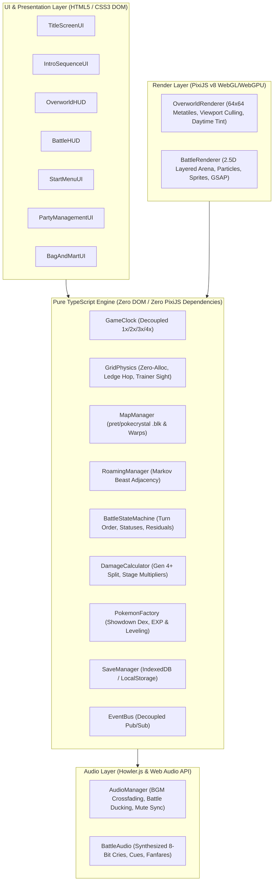

# Crystal Overdrive — System Architecture & Technical Specifications

**Version:** 0.3.0 (Phase 3 Complete)  
**Engine:** PixiJS v8 + TypeScript 5.x + Vite  
**Target Platform:** Modern Web Browsers (WebGL 2.0 / WebGPU)

---

## 1. Executive Overview & Core Architectural Pillars

**Crystal Overdrive** is a high-performance, browser-based recreation of *Pokémon Crystal* designed with an authentic Johto world, modernized Gen 4+ battle mechanics, and zero-allocation game loops.



### Core Architectural Pillars
1. **Strict Separation of Concerns:**
   - Modules in `src/core/`, `src/world/`, and `src/battle/` are **pure TypeScript** with zero imports from `pixi.js` or the browser DOM. This guarantees 100% headless testability in Vitest.
   - `src/render/` handles all GPU canvas operations.
   - `src/ui/` renders vector DOM overlays for crisp high-DPI typography and flexible layouts.
2. **Decoupled Speed Scaling (`1x` / `2x` / `3x` / `4x Overdrive`):**
   - **World Clock (`1.0x` fixed):** Ambient water animations, NPC wander steps, and time-of-day transitions always progress at real-time 1.0x speed.
   - **Player Movement (`1x | 2x | 3x | 4x`):** Player movement speed scales by `playerSpeedMultiplier` using fractional progress overflow chaining so fast movement never clips collision boundaries.
   - **Battle Speed (`1x | 2x | 3x | 4x`):** All battle animations, HP bar drain tweens, and typewriter text delays divide by `battleSpeedMultiplier`.
3. **Zero-Allocation Physics & Rendering:**
   - The game loop avoids garbage collection spikes by reusing coordinate scratch objects, array iterators, and continuous interpolation math.

---

## 2. Directory Structure & Module Boundaries

```
src/
├── core/                  # Engine Foundation & Cross-Cutting Concerns
│   ├── GameClock.ts       # Decoupled timekeeper (world vs player vs battle speed)
│   ├── EventBus.ts        # Typed pub/sub event emitter
│   └── SaveManager.ts     # SaveState serialization & localStorage persistence
├── world/                 # Overworld Mechanics & Spatial Partitioning
│   ├── GridPhysics.ts     # Collision detection, ledges, and trainer line-of-sight
│   ├── MapManager.ts      # Binary map loader (.blk), seamless neighbor connections
│   ├── RoamingManager.ts  # Markov transition adjacency for Raikou, Entei, Suicune
│   └── npcData.ts         # Canonical Johto NPC & Trainer placements across all maps
├── battle/                # Turn-Based Tactical Combat System
│   ├── BattleStateMachine.ts # Round execution, turn-order resolution, and residuals
│   ├── DamageCalculator.ts   # Gen 4+ split, STAB, criticals, stat stages (-6 to +6)
│   ├── PokemonFactory.ts     # Showdown Dex integration, EXP gain, level-up calculation
│   ├── CatchCalculator.ts    # Gen 2 & Gen 4 Pokeball catch probabilities
│   └── EffectivenessHelper.ts # Live Unbound-style type multiplier badges, hit shake specs, and ball palettes
├── render/                # GPU Canvas Graphics (PixiJS v8)
│   ├── OverworldRenderer.ts  # 64x64 tiles, tall grass tufts, day/night tints, culling
│   └── BattleRenderer.ts     # 2.5D stage, custom Pokeball arcs, Physical/Special hit FX, camera shakes
├── ui/                    # Vector DOM Overlays & Interactivity (100dvh + Safe-Area Inset Aware + Device-Adaptive)
│   ├── TitleScreenUI.ts      # Crystalline Title Screen, Audio Unlock Gate, SavePreview Card, Overwrite & Options Modals
│   ├── IntroSequenceUI.ts    # 6-Stage Prof. Oak Intro, Authentic Marill Sprite, Gender Select (Boy/Girl), 15-Char Name Input & Presets, RTC Sync
│   ├── OverworldHUD.ts       # Device-adaptive top menu capsule, Elevated Mobile Touch Gamepad, story-gated Roamer radar, dialogue typewriter
│   ├── BattleHUD.ts          # Asymmetrical HUD cards, 6-dot party dock, device-adaptive Unbound 2x2 move matrix & hotkeys
│   ├── StartMenuUI.ts        # Classic start menu (Pokedex, Pokemon, Bag, Save)
│   ├── PartyManagementUI.ts  # Full party inspector, lead reordering, summaries
│   └── BagAndMartUI.ts       # Progressive Mart inventory, out-of-battle medicine
├── audio/                 # Audio Engine
│   ├── AudioManager.ts       # Seamless BGM crossfader (.webm/.mp3), battle ducking, and mute persistence
│   └── BattleAudio.ts        # Pure Web Audio synthesized 8-bit cries and sound effects
└── types/                 # Shared Data Models & Interfaces
    └── game.d.ts          # Strongly-typed schemas for maps, entities, and battle state
```

---

## 3. Core Data Schemas & State Models

### 3.1 Pokémon Instance (`src/types/game.d.ts`)
```typescript
export interface PokemonInstance {
  uid: string;
  speciesId: string;
  nickname: string;
  level: number;
  types: [PokemonType] | [PokemonType, PokemonType];
  baseStats: BaseStats;
  stats: BaseStats;
  currentHp: number;
  status: StatusCondition;      // 'NONE' | 'PAR' | 'SLP' | 'FRZ' | 'BRN' | 'PSN' | 'TOX'
  sleepTurns?: number;          // 1-3 turns for SLP condition
  statStages?: StatStages;      // -6 to +6 stages for atk, def, spa, spd, spe, acc, eva
  exp?: number;
  nextLevelExp?: number;
  isTrapped: boolean;
  moves: Array<{ moveId: string; currentPp: number; maxPp: number }>;
  catchRate: number;
  isEgg?: boolean;
  eggSteps?: number;
}
```

### 3.2 Overworld Map Data (`public/assets/data/maps/*.json`)
```typescript
export interface MapData {
  id: string;
  name: string;
  width: number;
  height: number;
  tileMap?: string[];           // Array of 64x64 metatile IDs (length = width * height)
  collisionGrid: number[][];    // 0 = Walkable, 1 = Solid, 2 = Tall Grass, 3 = Water, 4 = Ledge DOWN, 5 = Ledge UP, 6 = Ledge LEFT, 7 = Ledge RIGHT
  warps: WarpEvent[];           // Warp triggers to interior/exterior maps
  entities: EntitySpawn[];      // NPC spawns with dialogue, direction, and sight range
  wildEncounters?: WildEncounterTable; // Morning, Day, and Night spawn tables
  connections?: {               // Seamless multi-map rendering connections
    north?: { mapId: string; offset: number };
    south?: { mapId: string; offset: number };
    east?: { mapId: string; offset: number };
    west?: { mapId: string; offset: number };
  };
}

export type NpcSpriteType =
  | 'boy' | 'girl' | 'fat_man' | 'kris'
  | 'silver' | 'fisherman' | 'bug_catcher' | 'teacher' | 'mom' | 'prof_elm'
  | 'sage' | 'elder' | 'elder_li' | 'falkner' | 'bird_keeper' | 'earl';
```

### 3.3 Roaming Beast Markov Graph (`src/world/RoamingManager.ts`)
The three legendary beasts (*Raikou*, *Entei*, *Suicune*) stay dormant in Ecruteak's Burned Tower until awakened by story events. Once active, their positions transition across an adjacency graph upon player route transitions:
- $P(\text{Stay}) = 0.50$
- $P(\text{Move to Adjacent Route}) = 0.35$
- $P(\text{Converge toward Player}) = 0.15$

### 3.4 Save State, Options & Title Preview (`src/core/SaveManager.ts`, `src/types/game.d.ts`)
```typescript
export type PlayerGender = 'BOY' | 'GIRL';

export interface GameOptions {
  soundVolume: number;      // 0.0 - 1.0 (default: 0.7)
  bgmVolume: number;        // 0.0 - 1.0 (default: 0.7)
  textSpeed: 'SLOW' | 'MID' | 'FAST' | 'INSTANT'; // (default: 'MID')
  battleAnimations: boolean; // (default: true)
  playerSpeedDefault: SpeedMultiplier; // (default: 1)
}

export interface SavePreview {
  playerName: string;
  gender: PlayerGender;
  badgeCount: number;
  pokedexCount: number;
  playTimeFormatted: string; // "HH:MM" e.g. "01:24"
  currentLocationName: string; // e.g. "Player's House" or "New Bark Town"
  partyLeadSpeciesId?: string;
  partyLeadLevel?: number;
  timestamp: number;
}
```

---

## 4. Key Engine Lifecycles

### 4.1 Grid Movement & Fractional Overflow
In `GridPhysics.updateEntity`:
1. When input is held, the entity selects a target tile $(x + \Delta x, y + \Delta y)$.
2. Progress $p$ advances:
   $$p \leftarrow p + \frac{\Delta t \cdot \text{speedMultiplier}}{\text{BASE\_TRAVERSAL\_TIME}}$$
3. If $p \ge 1.0$, the entity snaps to $(x, y) = (\text{targetX}, \text{targetY})$, triggers `onTileEntered`, and chains any fractional overflow:
   $$\text{overflow} = p - 1.0$$
4. Render coordinates interpolate smoothly:
   $$\text{renderX} = x + (\text{targetX} - x) \cdot p$$

### 4.2 Multi-Directional Ledge Hopping Mechanics
When facing a Ledge tile in its permitted traversal direction (`collision === 4 (DOWN)`, `5 (UP)`, `6 (LEFT)`, `7 (RIGHT)`):
1. Destination is checked 2 tiles ahead in the movement direction $(x + 2\Delta x, y + 2\Delta y)$.
2. If walkable and unoccupied, a 2-tile parabolic jump is executed:
   - For vertical hops (DOWN/UP): $\text{renderY} = y + 2\Delta y \cdot p - 16 \cdot \sin(\pi \cdot p)$
   - For horizontal hops (LEFT/RIGHT): $\text{renderX} = x + 2\Delta x \cdot p, \quad \text{renderY} = y - 16 \cdot \sin(\pi \cdot p)$
3. An elliptical ground shadow is drawn at ground level during the arc, and `BattleAudio.playOverworldSound('HOP')` plays.

### 4.3 Battle Turn Event Stream
`BattleStateMachine.executeRound` processes round inputs (`FIGHT`, `BAG`, `SWITCH`, `RUN`) and returns a deterministic event stream:
- `ATTACK` -> `DAMAGE` -> `STAT_CHANGE` -> `STATUS` -> `RESIDUAL_DAMAGE` -> `FAINT`
- Battle UI and Renderer consume events sequentially with time-scaled async tweens.

---

## 5. Architectural Invariants & Verification Guardrails

Every code addition and pull request must strictly honor these five non-negotiable invariants:

1. **Strict Layer Isolation (Pure Logic vs. Render/UI):**
   - `src/core/`, `src/world/`, and `src/battle/` must remain **100% pure TypeScript logic**.
   - Zero imports from `pixi.js`, `@pixi/*`, or browser DOM APIs (`window`, `document`, `HTMLElement`).
   - Renderers (`src/render/`) and UI overlays (`src/ui/`) consume core events and state, never the reverse.
2. **Decoupled Player Speed & Collision Boundary Integrity:**
   - World clock (`GameClock.ts`) runs at fixed `1.0x` for NPC wandering, ambient animations, and roamer updates.
   - Player speed multiplier (`1x | 2x | 3x`) accelerates player movement and step cycles via normalized progress $p \in [0.0, 1.0]$.
   - Physics updates must use **fractional overflow chaining** (`accumulator -= stepTime`) so $3x$ speed never tunnels through or overshoots collision boundaries.
3. **Flat, Schema-Pure, JSON-Serializable State:**
   - All state stored in `SaveManager.ts` and defined in `src/types/game.d.ts` must be completely serializable (no circular structures, functions, Map/Set instances, or Pixi object references).
   - Guarantees asynchronous IndexedDB (`idb`) and `localStorage` persistence and compatibility with automated world parsing.
4. **Authentic Gen 4+ Battle & Catch Formula Fidelity:**
   - Gen 4+ Physical / Special / Status split (`move.category`).
   - Showdown-accurate damage formula with STAB ($1.5\times$), critical hits, weakness/resistance scaling, and deterministic $0.85$–$1.00$ damage rolls.
   - Status multipliers in catch calculations strictly calibrated: `SLEEP` / `FREEZE` = $2.0\times$, `PARALYSIS` / `POISON` / `BURN` = $1.5\times$.
   - Roaming beasts enforce a mandatory 2-turn grace window before attempting to flee (unless trapped by Mean Look / Block).
5. **Type Effectiveness UI Contract:**
   - Move effectiveness against active target must compute in real-time and produce verified UI classifications: `4x ULTRA`, `2x SUPER`, `1x NORMAL`, `0.5x / 0.25x NOT VERY`, and `0x IMMUNE`.
6. **Boundary Protection & Unmapped Area Guard:**
   - Warp callbacks and map transitions must validate that target map assets exist before triggering camera fades or coordinate mutations. Unmapped boundaries (e.g. gates to future cities, unlit caves) must be barred with canonical roadblock NPCs or solid collisions to prevent players from walking into unrendered space.

---

## 6. QA Verification Matrix & Test Standards

* **Test Framework:** Vitest (`vitest run`), configured for ultra-fast, in-memory execution (~45ms baseline).
* **Test Location & Naming:** `tests/<ModuleName>.test.ts`, matching corresponding source module in `src/`.
* **Deterministic Execution:** Seeded PRNG or explicit test vectors for RNG-heavy logic (damage rolls, catch rates, roamer graph selections).
* **Periodic Optimization Review Cadence:** Every 5 to 10 completed feature implementations (e.g. after Tickets 5.1–5.5, Tickets 6.1–6.5, etc.), an automated and manual health review is run via `npm run review` (`scripts/project-optimization-review.cjs`) to audit layer purity, NPC walkability, reciprocal warps, test suite, and bundle budgets.
* **Pre-Merge / Verification Gate:**
  1. `npm test` (All Vitest suites must pass with zero warnings).
  2. `npm run build` (`tsc` strict static type-check + Vite production bundle validation).
  3. `npm run review` (Full 5-stage health and boundary audit).
  4. **Documentation Invariant:** Update `CREDITS.md` if any new external assets, audio, sprites, or tools are added.
  5. **Architecture Invariant:** Update `ARCHITECTURE.md` if any data schemas, engine lifecycles, or interfaces are modified.

### 6.1 Current Test Coverage Matrix

| Module | Test Suite File | Current Tests | Status | Scope Verified |
| :--- | :--- | :---: | :---: | :--- |
| `GameClock.ts` | `tests/GameClock.test.ts` | 7 | ✅ Covered | Decoupled player vs world delta, pausing, time dilation, Johto TimeOfDay calculation (Morning/Day/Night), simulated hours, and ambient tint values (Ticket 6.2). |
| `GridPhysics.ts` | `tests/GridPhysics.test.ts` | 15 | ✅ Covered | 1x/2x/3x speed, tile collision, bounds, fractional chaining, multi-directional ledge hopping (4..9), trainer vision, and wall collision bump callback (Ticket 6.3). |
| `MapData.ts` | `tests/MapData.test.ts` | 18 | ✅ Covered | Binary map extraction schema, warp coords, reciprocal warps, Sprout Tower, Violet Gym & Falkner, Post-Gym Togepi Egg Aide, Elm's Lab starter Poké Ball `bgEvents` & Route 29 roadblock (Ticket 6.1), time-of-day encounter rolling & outdoor classification (Ticket 6.2), 100% NPC walkability guard (`0`/`2`). |
| `RoamingManager.ts`| `tests/RoamingManager.test.ts` | 4 | ✅ Covered | Adjacency graph traversal, route weighting, active state, Burned Tower dormancy. |
| `CatchCalculator.ts`| `tests/CatchCalculator.test.ts` | 6 | ✅ Covered | Modern Pokéball multipliers (Quick, Dusk, Net, etc.), status modifiers. |
| `DamageCalculator.ts`| `tests/DamageCalculator.test.ts`| 11 | ✅ Covered | Physical/Special split, STAB, crits, dual-type damage, stat stage modifiers (-6 to +6), Unbound pill styles & hit shake specs. |
| `PokemonFactory.ts` | `tests/PokemonFactory.test.ts` | 6 | ✅ Covered | `createEgg`, battle switch Egg guard, Togepi Lv.1 hatch, Johto Starter Lv.5 creation (Ticket 6.1), Gen 2 learnset move lookup at level, and move inspect tooltip metadata (Ticket 6.4). |
| `SaveManager.ts` | `tests/SaveManager.test.ts` | 6 | ✅ Covered | IndexedDB / localStorage serialization, `SavePreview` extraction, `GameOptions` defaults, `formatPlayTime`, legacy save migration. |
| `AudioManager.ts` | `tests/AudioManager.test.ts` | 6 | ✅ Covered | Map-to-BGM track resolution, gain staging math, battle ducking/restoration, mute sync, and retro overworld SFX (BUMP, HOP, RUSTLE, HEAL_JINGLE, FANFARE) (Ticket 6.3). |
| `TitleScreenUI.ts` | `tests/TitleScreenUI.test.ts` | 6 | ✅ Covered | Default menu focus (`CONTINUE` vs `NEW_GAME`), `SavePreview` summary binding, audio unlock gate, keyboard navigation, overwrite confirmation modal, `GameOptions` updates. |
| `IntroSequenceUI.ts` | `tests/IntroSequenceUI.test.ts` | 4 | ✅ Covered | 6-stage state machine progression, Boy/Girl preset selection, 1-15 char name validation/fallback, RTC period detection, `onComplete` payload. |
| **Current Baseline** | **11 Suites** | **89 Tests** | **100% Pass** | **All Active Tests Passing (`npm test`)** |

### 6.2 QA Expansion Roadmap (Target Verifications)
- `BattleStateMachine.ts`: Dedicated suite for turn priorities, 2-turn roamer flee rule, trapped state, and faint flows.
- `EffectivenessHelper.ts`: Dedicated standalone suite for Unbound badge mapping and complex dual-type effectiveness.
- `PokemonFactory.ts`: Dedicated suite for `@pkmn/dex` hydration, IV/DV calculations, and learnset resolution.
