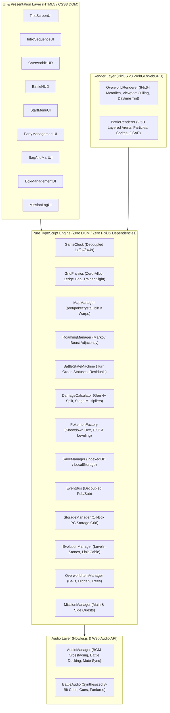
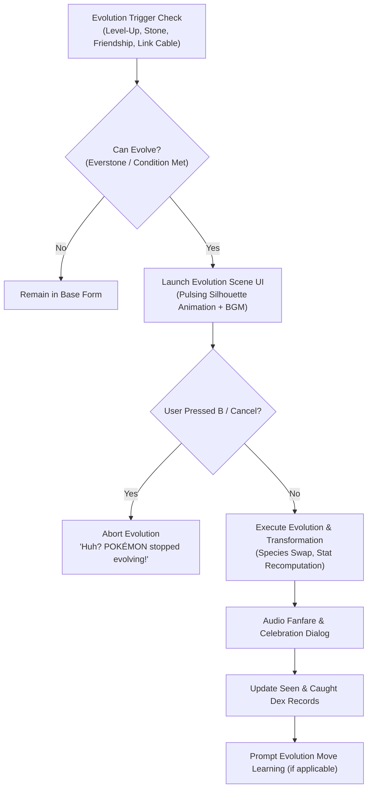

# Crystal Overdrive — System Architecture & Technical Specifications

**Version:** 0.3.0 (Phase 3 Complete)  
**Engine:** PixiJS v8 + TypeScript 5.x + Vite  
**Target Platform:** Modern Web Browsers (WebGL 2.0 / WebGPU)

---

## 1. Executive Overview & Core Architectural Pillars

**Crystal Overdrive** is a high-performance, browser-based recreation of *Pokémon Crystal* designed with an authentic Johto world, modernized Gen 4+ battle mechanics, and zero-allocation game loops.



### Core Architectural Pillars
1. **Strict Separation of Concerns:**
   - Modules in `src/core/`, `src/world/`, and `src/battle/` are **pure TypeScript** with zero imports from `pixi.js` or the browser DOM. This guarantees 100% headless testability in Vitest.
   - `src/render/` handles all GPU canvas operations.
   - `src/ui/` renders vector DOM overlays for crisp high-DPI typography and flexible layouts.
2. **Decoupled Speed Scaling (`1x` / `2x` / `3x` / `4x Overdrive`):**
   - **World Clock (`1.0x` fixed):** Ambient water animations, NPC wander steps, and time-of-day transitions always progress at real-time 1.0x speed.
   - **Player Movement (`1x | 2x | 3x | 4x`):** Player movement speed scales by `playerSpeedMultiplier` using fractional progress overflow chaining so fast movement never clips collision boundaries.
   - **Battle Speed (`1x | 2x | 3x | 4x`):** All battle animations, HP bar drain tweens, and typewriter text delays divide by `battleSpeedMultiplier`.
3. **Zero-Allocation Physics & Rendering:**
   - The game loop avoids garbage collection spikes by reusing coordinate scratch objects, array iterators, and continuous interpolation math.

---

## 2. Directory Structure & Module Boundaries

```
src/
├── core/                  # Engine Foundation & Cross-Cutting Concerns
│   ├── GameClock.ts       # Decoupled timekeeper (world vs player vs battle speed)
│   ├── EventBus.ts        # Typed pub/sub event emitter
│   └── SaveManager.ts     # SaveState serialization & localStorage persistence
├── world/                 # Overworld Mechanics & Spatial Partitioning
│   ├── GridPhysics.ts     # Collision detection, ledges, and trainer line-of-sight
│   ├── MapManager.ts      # Binary map loader (.blk), seamless neighbor connections
│   ├── RoamingManager.ts  # Markov transition adjacency for Raikou, Entei, Suicune
│   ├── ItemfinderRadar.ts # Pure TS 8-tile dowsing compass radar & dynamic sonar math
│   ├── OverworldItemManager.ts # Field item balls, hidden items, and fruit tree daily harvest
│   ├── MissionManager.ts  # 15 Main & 21 Side quest tracking and step progression
│   ├── StorageManager.ts  # 14-box Pokémon storage engine (280 slots) with catch auto-deposit
│   ├── EvolutionManager.ts # Pure domain evolution logic (levels, stones, Link Cable, friendship)
│   └── npcData.ts         # Canonical Johto NPC & Trainer placements across all maps
├── battle/                # Turn-Based Tactical Combat System
│   ├── BattleStateMachine.ts # Round execution, turn-order resolution, and residuals
│   ├── DamageCalculator.ts   # Gen 4+ split, STAB, criticals, stat stages (-6 to +6)
│   ├── PokemonFactory.ts     # Showdown Dex integration, EXP gain, level-up calculation
│   ├── CatchCalculator.ts    # Gen 2 & Gen 4 Pokeball catch probabilities
│   └── EffectivenessHelper.ts # Live Unbound-style type multiplier badges, hit shake specs, and ball palettes
├── render/                # GPU Canvas Graphics (PixiJS v8)
│   ├── OverworldRenderer.ts  # 64x64 tiles, tall grass tufts, day/night tints, culling
│   └── BattleRenderer.ts     # 2.5D stage, custom Pokeball arcs, Physical/Special hit FX, camera shakes
├── ui/                    # Vector DOM Overlays & Interactivity (100dvh + Safe-Area Inset Aware + Device-Adaptive)
│   ├── TitleScreenUI.ts      # Crystalline Title Screen, Audio Unlock Gate, SavePreview Card, Overwrite & Options Modals
│   ├── IntroSequenceUI.ts    # 6-Stage Prof. Oak Intro, Authentic Marill Sprite, Gender Select (Boy/Girl), 15-Char Name Input & Presets, RTC Sync
│   ├── NamingModalUI.ts       # Centered Rival naming modal with presets (SILVER, KAZU, KAMON, RED) & 15-char input
│   ├── OverworldHUD.ts       # Device-adaptive top menu capsule, Elevated Mobile Touch Gamepad, story-gated Roamer radar, dialogue typewriter
│   ├── ItemfinderHUD.ts      # Top-right floating Itemfinder dowsing compass capsule with rotating needle & gold lock-on state
│   ├── MissionLogUI.ts       # Unbound-style mission tracker with categorized tabs and objective steps
│   ├── BoxManagementUI.ts    # Split-view Bill's PC 14-box storage grid & party transfer manager
│   ├── BattleHUD.ts          # Asymmetrical HUD cards, 6-dot party dock, device-adaptive Unbound 2x2 move matrix & hotkeys
│   ├── StartMenuUI.ts        # Classic start menu (Pokedex, Pokemon, Bag, Save)
│   ├── PartyManagementUI.ts  # Full party inspector, lead reordering, summaries
│   └── BagAndMartUI.ts       # Progressive Mart inventory, out-of-battle medicine
├── audio/                 # Audio Engine
│   ├── AudioManager.ts       # Seamless BGM crossfader (.webm/.mp3), battle ducking, and mute persistence
│   └── BattleAudio.ts        # Pure Web Audio synthesized 8-bit cries and sound effects
└── types/                 # Shared Data Models & Interfaces
    └── game.d.ts          # Strongly-typed schemas for maps, entities, and battle state
```

---

## 3. Core Data Schemas & State Models

### 3.1 Pokémon Instance (`src/types/game.d.ts`)
```typescript
export interface PokemonInstance {
  uid: string;
  speciesId: string;
  nickname: string;
  level: number;
  types: [PokemonType] | [PokemonType, PokemonType];
  baseStats: BaseStats;
  stats: BaseStats;
  currentHp: number;
  status: StatusCondition;      // 'NONE' | 'PAR' | 'SLP' | 'FRZ' | 'BRN' | 'PSN' | 'TOX'
  sleepTurns?: number;          // 1-3 turns for SLP condition
  statStages?: StatStages;      // -6 to +6 stages for atk, def, spa, spd, spe, acc, eva
  exp?: number;
  nextLevelExp?: number;
  isTrapped: boolean;
  moves: Array<{ moveId: string; currentPp: number; maxPp: number }>;
  catchRate: number;
  isEgg?: boolean;
  eggSteps?: number;
}
```

### 3.2 Overworld Map Data (`public/assets/data/maps/*.json`)
```typescript
export interface MapData {
  id: string;
  name: string;
  width: number;
  height: number;
  tileMap?: string[];           // Array of 64x64 metatile IDs (length = width * height)
  collisionGrid: number[][];    // 0 = Walkable, 1 = Solid, 2 = Tall Grass, 3 = Water, 4 = Ledge DOWN, 5 = Ledge UP, 6 = Ledge LEFT, 7 = Ledge RIGHT
  warps: WarpEvent[];           // Warp triggers to interior/exterior maps
  entities: EntitySpawn[];      // NPC spawns with dialogue, direction, and sight range
  wildEncounters?: WildEncounterTable; // Morning, Day, and Night spawn tables
  connections?: {               // Seamless multi-map rendering connections
    north?: { mapId: string; offset: number };
    south?: { mapId: string; offset: number };
    east?: { mapId: string; offset: number };
    west?: { mapId: string; offset: number };
  };
}

export type NpcSpriteType =
  | 'boy' | 'girl' | 'fat_man' | 'kris'
  | 'silver' | 'fisherman' | 'bug_catcher' | 'teacher' | 'mom' | 'prof_elm'
  | 'sage' | 'elder' | 'elder_li' | 'falkner' | 'bird_keeper' | 'earl' | 'oak';
```

### 3.3 Overworld Items & Scattered Pickups (`public/assets/data/overworld_items.json`)
Authentic extraction of all 246 scattered overworld pickups from Pokémon Crystal (`scripts/pokecrystal_raw/maps__*.asm`):
- **136 Visible Item Balls** (`OBJECTTYPE_ITEMBALL`): Parsed directly with event flag mappings.
- **80 Hidden Items** (`BGEVENT_ITEM`): Parsed from background event triggers with flags.
- **30 Fruit Trees** (`SPRITE_FRUIT_TREE` / `fruittree`): Parsed and resolved against `data/items/fruit_trees.asm` berry tables.
- **Indexed Structure**: Includes overall and regional summary stats (Johto: 173 items, Kanto: 73 items), flat category arrays, and an O(1) `byMap` index containing map-scoped item balls, hidden items, and fruit trees.

```typescript
export interface OverworldItemsPayload {
  summary: {
    totalItemBalls: number;    // 136
    totalHiddenItems: number;  // 80
    totalFruitTrees: number;   // 30
    total: number;             // 246
    totalMapsWithItems: number;// 93
    johto: { itemBalls: 103, hiddenItems: 48, fruitTrees: 22, total: 173 };
    kanto: { itemBalls: 33, hiddenItems: 32, fruitTrees: 8, total: 73 };
  };
  itemBalls: ItemBallEntry[];
  hiddenItems: HiddenItemEntry[];
  fruitTrees: FruitTreeEntry[];
  byMap: Record<string, {
    mapId: string;
    region: 'johto' | 'kanto';
    itemBalls: ItemBallEntry[];
    hiddenItems: HiddenItemEntry[];
    fruitTrees: FruitTreeEntry[];
  }>;
}
```

### 3.4 Roaming Beast Markov Graph (`src/world/RoamingManager.ts`)
The three legendary beasts (*Raikou*, *Entei*, *Suicune*) stay dormant in Ecruteak's Burned Tower until awakened by story events. Once active, their positions transition across an adjacency graph upon player route transitions:
- $P(\text{Stay}) = 0.50$
- $P(\text{Move to Adjacent Route}) = 0.35$
- $P(\text{Converge toward Player}) = 0.15$

### 3.4 Save State, Options & Title Preview (`src/core/SaveManager.ts`, `src/types/game.d.ts`)
```typescript
export type PlayerGender = 'BOY' | 'GIRL';

export interface GameOptions {
  soundVolume: number;      // 0.0 - 1.0 (default: 0.7)
  bgmVolume: number;        // 0.0 - 1.0 (default: 0.7)
  textSpeed: 'SLOW' | 'MID' | 'FAST' | 'INSTANT'; // (default: 'MID')
  battleAnimations: boolean; // (default: true)
  playerSpeedDefault: SpeedMultiplier; // (default: 1)
}

export interface SavePreview {
  playerName: string;
  gender: PlayerGender;
  badgeCount: number;
  pokedexCount: number;
  playTimeFormatted: string; // "HH:MM" e.g. "01:24"
  currentLocationName: string; // e.g. "Player's House" or "New Bark Town"
  partyLeadSpeciesId?: string;
  partyLeadLevel?: number;
  timestamp: number;
}
```

---

## 4. Key Engine Lifecycles

### 4.1 Grid Movement & Fractional Overflow
In `GridPhysics.updateEntity`:
1. When input is held, the entity selects a target tile $(x + \Delta x, y + \Delta y)$.
2. Progress $p$ advances:
   $$p \leftarrow p + \frac{\Delta t \cdot \text{speedMultiplier}}{\text{BASE\_TRAVERSAL\_TIME}}$$
3. If $p \ge 1.0$, the entity snaps to $(x, y) = (\text{targetX}, \text{targetY})$, triggers `onTileEntered`, and chains any fractional overflow:
   $$\text{overflow} = p - 1.0$$
4. Render coordinates interpolate smoothly:
   $$\text{renderX} = x + (\text{targetX} - x) \cdot p$$

### 4.2 Multi-Directional Ledge Hopping Mechanics
When facing a Ledge tile in its permitted traversal direction (`collision === 4 (DOWN)`, `5 (UP)`, `6 (LEFT)`, `7 (RIGHT)`):
1. Destination is checked 2 tiles ahead in the movement direction $(x + 2\Delta x, y + 2\Delta y)$.
2. If walkable and unoccupied, a 2-tile parabolic jump is executed:
   - For vertical hops (DOWN/UP): $\text{renderY} = y + 2\Delta y \cdot p - 16 \cdot \sin(\pi \cdot p)$
   - For horizontal hops (LEFT/RIGHT): $\text{renderX} = x + 2\Delta x \cdot p, \quad \text{renderY} = y - 16 \cdot \sin(\pi \cdot p)$
3. An elliptical ground shadow is drawn at ground level during the arc, and `BattleAudio.playOverworldSound('HOP')` plays.

### 4.3 Battle Turn Event Stream
`BattleStateMachine.executeRound` processes round inputs (`FIGHT`, `BAG`, `SWITCH`, `RUN`) and returns a deterministic event stream:
- `ATTACK` -> `DAMAGE` -> `STAT_CHANGE` -> `STATUS` -> `RESIDUAL_DAMAGE` -> `FAINT`
- Battle UI and Renderer consume events sequentially with time-scaled async tweens.

---

## 5. Architectural Invariants & Verification Guardrails

Every code addition and pull request must strictly honor these five non-negotiable invariants:

1. **Strict Layer Isolation (Pure Logic vs. Render/UI):**
   - `src/core/`, `src/world/`, and `src/battle/` must remain **100% pure TypeScript logic**.
   - Zero imports from `pixi.js`, `@pixi/*`, or browser DOM APIs (`window`, `document`, `HTMLElement`).
   - Renderers (`src/render/`) and UI overlays (`src/ui/`) consume core events and state, never the reverse.
2. **Decoupled Player Speed & Collision Boundary Integrity:**
   - World clock (`GameClock.ts`) runs at fixed `1.0x` for NPC wandering, ambient animations, and roamer updates.
   - Player speed multiplier (`1x | 2x | 3x`) accelerates player movement and step cycles via normalized progress $p \in [0.0, 1.0]$.
   - Physics updates must use **fractional overflow chaining** (`accumulator -= stepTime`) so $3x$ speed never tunnels through or overshoots collision boundaries.
3. **Flat, Schema-Pure, JSON-Serializable State:**
   - All state stored in `SaveManager.ts` and defined in `src/types/game.d.ts` must be completely serializable (no circular structures, functions, Map/Set instances, or Pixi object references).
   - Guarantees asynchronous IndexedDB (`idb`) and `localStorage` persistence and compatibility with automated world parsing.
4. **Authentic Gen 4+ Battle & Catch Formula Fidelity:**
   - Gen 4+ Physical / Special / Status split (`move.category`).
   - Showdown-accurate damage formula with STAB ($1.5\times$), critical hits, weakness/resistance scaling, and deterministic $0.85$–$1.00$ damage rolls.
   - Status multipliers in catch calculations strictly calibrated: `SLEEP` / `FREEZE` = $2.0\times$, `PARALYSIS` / `POISON` / `BURN` = $1.5\times$.
   - Roaming beasts enforce a mandatory 2-turn grace window before attempting to flee (unless trapped by Mean Look / Block).
5. **Type Effectiveness UI Contract:**
   - Move effectiveness against active target must compute in real-time and produce verified UI classifications: `4x ULTRA`, `2x SUPER`, `1x NORMAL`, `0.5x / 0.25x NOT VERY`, and `0x IMMUNE`.
6. **Boundary Protection & Unmapped Area Guard:**
   - Warp callbacks and map transitions must validate that target map assets exist before triggering camera fades or coordinate mutations. Unmapped boundaries (e.g. gates to future cities, unlit caves) must be barred with canonical roadblock NPCs or solid collisions to prevent players from walking into unrendered space.

---

## 6. QA Verification Matrix & Test Standards

* **Test Framework:** Vitest (`vitest run`), configured for ultra-fast, in-memory execution (~45ms baseline).
* **Test Location & Naming:** `tests/<ModuleName>.test.ts`, matching corresponding source module in `src/`.
* **Deterministic Execution:** Seeded PRNG or explicit test vectors for RNG-heavy logic (damage rolls, catch rates, roamer graph selections).
* **Periodic Optimization Review Cadence:** Every 5 to 10 completed feature implementations (e.g. after Tickets 5.1–5.5, Tickets 6.1–6.5, etc.), an automated and manual health review is run via `npm run review` (`scripts/project-optimization-review.cjs`) to audit layer purity, NPC walkability, reciprocal warps, test suite, and bundle budgets.
* **Pre-Merge / Verification Gate:**
  1. `npm test` (All Vitest suites must pass with zero warnings).
  2. `npm run build` (`tsc` strict static type-check + Vite production bundle validation).
  3. `npm run review` (Full 5-stage health and boundary audit).
  4. **Documentation Invariant:** Update `CREDITS.md` if any new external assets, audio, sprites, or tools are added.
  5. **Architecture Invariant:** Update `ARCHITECTURE.md` if any data schemas, engine lifecycles, or interfaces are modified.

### 6.1 Current Test Coverage Matrix

| Module | Test Suite File | Current Tests | Status | Scope Verified |
| :--- | :--- | :---: | :---: | :--- |
| `GameClock.ts` | `tests/GameClock.test.ts` | 7 | ✅ Covered | Default 3x player speed, battle speed capped at 3x (1/2/3 cycle), decoupled player vs world vs battle delta, pausing, time dilation, Johto TimeOfDay calculation (Morning/Day/Night), simulated hours, and ambient tint values (Ticket 6.2, TICKET-UX-BATTLE-3X-SPEED-AND-PACING-01). |
| `GridPhysics.ts` | `tests/GridPhysics.test.ts` | 19 | ✅ Covered | 1x/2x/3x speed, tile collision, bounds, fractional chaining, multi-directional 2-tile and 3-tile ledge hopping (4..9), trainer vision, wall collision bump callback, and authentic GBC directional carpet thresholds (`COLL_WARP_CARPET_DOWN`) suppressing sideways/UP moves and triggering on DOWN egress (Ticket 6.3, Sprint 08, TICKET-POLISH-AUTHENTIC-DOOR-MECHANICS-01). |
| `MapData.ts` | `tests/MapData.test.ts` | 35 | ✅ Covered | Binary map extraction schema, warp coords, reciprocal warps, Sprout Tower, Violet Gym & Falkner, Post-Gym Togepi Egg Aide, Elm's Lab starter Poké Ball `bgEvents`, table Poké Ball sprite despawn rules (`getStarterBallsForLab`), Mr. Pokémon's House Prof. Oak departure & Mystery Egg handover (`BUGFIX-NARRATIVE-01`), Route 29 roadblock (Ticket 6.1), time-of-day encounter rolling & outdoor classification (Ticket 6.2), 100% NPC walkability guard (`0`/`2`), Phase 7 South Johto, Phase 8 Goldenrod Metropolis & Day-Care Route 34, Phase 9 Central Johto, Phase 10 Western Johto, Phase 11 (Mahogany, Rocket Hideout, Lake of Rage, Ice Path, Blackthorn, Dragon's Den, Routes 42–46, Leaders Pryce & Clair), Phase 12 (Routes 26/27, Tohjo Falls, Victory Road, Routes 22/23, Indigo Plateau Elite Four & Champion Lance, Route 28, Mt. Silver & Red), Phase 13 Western & Central Kanto (Pallet Town, Viridian City, Pewter City, Cerulean City, Routes 1–4, 24–25, Leaders Brock, Misty, Blue), Phase 14 Central & Eastern Kanto (Vermilion City, Celadon City, Lavender Town, Rock Tunnel, Routes 5–11, S.S. Aqua Fast Ship, Leaders Lt. Surge & Erika), Phase 15 Southern Kanto, Saffron & Sea Routes (Saffron City, Fuchsia City, Cinnabar Island, Cycling Road, Seafoam Gym, Routes 12–21, Leaders Sabrina, Janine, Blaine), Ruins of Alph solid cave roofs & Route 36 gate reciprocal warps with optional warp facing `direction` (BUGFIX-RUINS-OF-ALPH-WARPS-COLLISION-01), Sprint 09 `world_maps.json` single-payload consolidation & retro GBC loader, and canonical GBC door transitions (`resolveWarpTransition`), outdoor doorstep landing (`targetY + 1` facing `DOWN`), debounced 320ms input lock, and dedicated audio cues (`DOOR_ENTER`, `DOOR_EXIT`, `STAIRS_STEP`, `CAVE_WARP`) (TICKET-POLISH-AUTHENTIC-DOOR-MECHANICS-01). Complete closed-loop world (315 maps). |
| `RoamingManager.ts`| `tests/RoamingManager.test.ts` | 4 | ✅ Covered | Adjacency graph traversal, route weighting, active state, Burned Tower dormancy. |
| `CatchCalculator.ts`| `tests/CatchCalculator.test.ts` | 6 | ✅ Covered | Modern Pokéball multipliers (Quick, Dusk, Net, etc.), status modifiers. |
| `DamageCalculator.ts`| `tests/DamageCalculator.test.ts`| 11 | ✅ Covered | Physical/Special split, STAB, crits, dual-type damage, stat stage modifiers (-6 to +6), Unbound pill styles & hit shake specs. |
| `PokemonFactory.ts` | `tests/PokemonFactory.test.ts` | 6 | ✅ Covered | `createEgg`, battle switch Egg guard, Togepi Lv.1 hatch, Johto Starter Lv.5 creation (Ticket 6.1), Gen 2 learnset move lookup at level, and move inspect tooltip metadata (Ticket 6.4). |
| `SaveManager.ts` | `tests/SaveManager.test.ts` | 6 | ✅ Covered | IndexedDB / localStorage serialization, `SavePreview` extraction, `GameOptions` defaults, `formatPlayTime`, legacy save migration. |
| `AudioManager.ts` | `tests/AudioManager.test.ts` | 6 | ✅ Covered | Map-to-BGM track resolution, gain staging math, battle ducking/restoration, mute sync, and retro overworld SFX (BUMP, HOP, RUSTLE, HEAL_JINGLE, FANFARE) (Ticket 6.3). |
| `TitleScreenUI.ts` | `tests/TitleScreenUI.test.ts` | 6 | ✅ Covered | Default menu focus (`CONTINUE` vs `NEW_GAME`), `SavePreview` summary binding, audio unlock gate, keyboard navigation, overwrite confirmation modal, `GameOptions` updates. |
| `IntroSequenceUI.ts` | `tests/IntroSequenceUI.test.ts` | 4 | ✅ Covered | 6-stage state machine progression, Boy/Girl preset selection, 1-15 char name validation/fallback, RTC period detection, `onComplete` payload. |
| `StartMenuUI.ts` / `BagAndMartUI.ts` / `OverworldHUD.ts` / `BattleHUD.ts` / `MissionLogUI.ts` / `ItemfinderHUD.ts` | `tests/SettingsAndMartUI.test.ts` | 19 | ✅ Covered | Settings submenu with sound toggle, speed cycle, touch controls, D-Pad vs Virtual Analog Joystick control style, and 3-state Unbound `EXP. SHARE MODE` (`OFF` / `ALL` / `CAPPED`); separate Poké Mart counter view & bag view; mobile D-pad ergonomics, dynamic Trainer Card name, P/K/B/G/M/T/S/O shortcuts, 6-slot Poké Ball healing animation at fixed canonical speed, canonical field rest blackout fade (`playFieldRestAnimation`) & top-aligned floating pill toast (`#overworld-toast-banner`), interactive `#move-learn-modal` pointer-events & keyboard shortcuts, Unbound-style `MissionLogUI`, `ItemfinderHUD` compass capsule states, and persisted `battleSpeedMultiplier` & `touchControlStyle` (Sprint 08, Sprint 10, Sprint 11, UI-HEALING-POLISH-01, KEY-ITEMS-UNBOUND-01). `BattleHUD` zero-spill 2-column move grid (`minmax(0, 1fr)`) for 440-480px phones, full-width dialogue/action tray swap, and accelerated dialogue timing (12ms/char + 500ms) decoupled from battle speed across 1x, 2x, and 3x (UI-BATTLE-ERGONOMICS-SPEED-01, TICKET-UX-BATTLE-3X-SPEED-AND-PACING-01). |
| `overworld_items.json` / `OverworldItemManager.ts` | `tests/OverworldItems.test.ts` | 11 | ✅ Covered | Authentic pret/pokecrystal scattered overworld item extraction (136 item balls, 80 hidden items, 30 fruit trees = 246 total), Johto (173) vs Kanto (73) regional integrity, valid coordinates & event flags, and `OverworldItemManager` item ball collection/despawn, solid obstacle collision (`isSolidObstacle`), hidden item detection, fruit tree daily harvest reset, Itemfinder 8-tile radar bearings, and pocket classification (Sprint 12, PC-RADAR-COLLISION-01). |
| `MissionManager.ts` / `missionData.ts` | `tests/MissionManager.test.ts` | 4 | ✅ Covered | Unbound-style quest system hydrating all 15 Main Story Missions (M01–M15) and 21 Side Missions (S01–S21), category/status filtering, sequential step progression, `checkStoryFlags` auto-unlock/completion, and lossless save state serialization (Sprint 11). |
| `PokemonFactory.ts` / `SaveManager.ts` | `tests/ExpShare.test.ts` | 5 | ✅ Covered | Unbound-style 3-mode Exp. Share (`OFF`, `ALL`, `CAPPED`), default `CAPPED` save hydration, Johto/Kanto badge level caps (`15..85`), 100% active + 50% bench party distribution, and `1 EXP` clamping at/above level cap (KEY-ITEMS-UNBOUND-01). |
| `ItemfinderRadar.ts` | `tests/ItemfinderRadar.test.ts` | 5 | ✅ Covered | Pure TypeScript 8-tile dowsing radar scan, nearest uncollected hidden item vector lock, 8-way compass bearings, adjacent `FACING` detection, and dynamic sonar pitch $f(d) = 880 + (8-d)\times 120\text{ Hz}$ (KEY-ITEMS-UNBOUND-01). |
| `NamingModalUI.ts` / `main.ts` / `npcData.ts` | `tests/RivalAndAzalea.test.ts` | 10 | ✅ Covered | Passerby Rival counter-starter selection (Cyndaquil -> Totodile, Totodile -> Chikorita, Chikorita -> Cyndaquil), dropped Trainer Card `SILVER`, Police interrogation & 15-character naming modal with presets (`SILVER`, `KAZU`, `KAMON`, `RED`), `SaveData.rivalName` serialization/hydration, Slowpoke Well Team Rocket raid with Executive Proton (Koffing Lv. 14, Zubat Lv. 9), Kurt Apricorn ball crafting unlock + Lure Ball award, Azalea Gym Leader Bugsy battle (Metapod Lv. 14, Kakuna Lv. 14, Scyther Lv. 16), Hive Badge, TM49 Fury Cutter, field Cut, and Mission M03 completion (Sprint 13). |
| `StorageManager.ts` / `BoxManager.ts` / `BoxManagementUI.ts` | `tests/BoxManager.test.ts` | 13 | ✅ Covered | 14 storage boxes of 20 slots each (280 total capacity), automatic wild catch overflow into storage with transfer dialogue and fanfare, interactive PC terminals in all Pokémon Centers and player bedroom launching `BoxManagementUI`, decoupled inspection and exclusive button-driven party-box swapping (`[ ⇄ MOVE / SWAP ]`), mobile segmented tab buffer persistence, `pointer-events: auto !important` clickability, canonical `_front.png` inspector sprites with defensive `this.onerror=null` fallbacks, release double-check safeguard, party minimum protection (cannot deposit/release last conscious Pokémon), protected Roaming Beasts (Raikou, Entei, Suicune) release protection, and backward-compatible save migration (Sprint 13.5, Stitch Neo-Kanto Protocol, TICKET-UX-STORAGE-BUTTON-ONLY-SWAP-01). |
| `BagAndMartUI.ts` / `NamingModalUI.ts` / `npcData.ts` / `main.ts` | `tests/ProgressionNarrative.test.ts` | 9 | ✅ Covered | `TMS & HMS` pocket definitions for HM05/TM70 Flash, TM31 Mud-Slap, TM49 Fury Cutter, HM01 Cut with dynamic fallback for unknown TM ids, rival naming modal clickability (`pointer-events: auto !important`), mobile-friendly input (`inputmode`, 16px font, CLEAR button), empty-name SILVER fallback, peeking `nbt_rival` despawn/shove, and authentic 1:1 Cherrygrove City Guide Gent 6-leg scripted walking tour (`GUIDE_GENT_TOUR_LEGS`, simultaneous entity stepping/following, Stop 1–5 dialogues, Map Card award, and Leg 6 door entrance & overworld despawn) (BUGFIX-PROGRESSION-NARRATIVE-02 & TICKET-EVENT-GUIDE-GENT-WALKING-TOUR-01). |
| `OverworldItemManager.ts` / `SaveManager.ts` / `main.ts` | `tests/ElmsLabStarters.test.ts` | 7 | ✅ Covered | Elm's Lab table Poké Ball states (3 -> 2 -> 1 for all three starter choices), context-aware table inspection dialogues (empty spot / stolen ball / remaining ball), HM05 Flash as the sole Flash item (TM70 removed from Elder Li reward and Bag) and legacy TM70 save pruning (TICKET-NARRATIVE-ELMS-TABLE-POKEBALLS-01). |
| `EvolutionManager.ts` | `tests/EvolutionManager.test.ts` | 20 | ✅ Covered | Pure domain evolution engine: level-up thresholds (starters, Tyrogue Atk/Def stat branches), evolutionary stones (Fire, Water, Thunder, Leaf, Moon, Sun), single-player Link Cable / Link Stone trade evolutions, friendship happiness scale (>= 220, Day/Night Eevee branch, baby Pokémon), Everstone invariant suppression, and stat recalculation with proportional HP preservation (Ticket 14.1). |
| `EvolutionSceneUI.ts` | `tests/EvolutionSceneUI.test.ts` | 6 | ✅ Covered | Fullscreen Evolution Sequence UI (Google Stitch Neo-Kanto Protocol): 3-phase silhouette oscillation engine (1 Hz to 8 Hz ramp), B-button / Escape cancellation guardrail during `[0.5s, 9.5s]` window with climax lockout, and post-evolution celebration modal with stat deltas and new typing capsules (Ticket 14.2). |
| `PokemonSprites` / `pokemon/*.png` | `tests/PokemonSprites.test.ts` | 5 | ✅ Covered | 100% complete Generation 1 & 2 sprite asset verification across all 251 species (IDs 1–251, Bulbasaur to Celebi): 251 front battle sprites (96x96), 251 back battle sprites (96x96), 251 party/box mini-icons (40x30), special naming alias fallbacks (Mr. Mime, Ho-Oh, Nidoran-F, Nidoran-M), and Route 36 Sudowoodo overworld sprite assets (144x32 walk sheet & 16x32 GBC). |
| `MapTileIntegrity` / `MoveReplacementModalUI.ts` | `tests/MapTileIntegrity.test.ts` | 14 | ✅ Covered | 100% map tile integrity across all 315 maps (944 warps landing strictly on walkable tiles 0/2, texture-collision coherence, zero missing tiles), Route 32 Union Cave mountain roof solid collision (y=77..78 x=0..9, west cliffs x=0..4, cave doorway 0 and safe apron landing 0), `PokemonFactory.canLearnMove` Gen 2 learnset tables, `MoveReplacementModalUI` 4-move tactical replacement with canonical "Poof!" dialogue and safe cancellation, `BagAndMartUI` party compatibility ABLE / NOT ABLE badges and shop ball catalog badge filtering, and Bill's PC `[ ⇄ MOVE / SWAP ]` / `[ 📋 SUMMARY ]` primary actions, demoted tertiary release button (`28px`, slate `#64748B`), and in-game double confirmation safety modal (TICKET-UX-TMHM-RELEASE-MAP-INTEGRITY-01). |
| `DaySiblings.ts` / `npcData.ts` | `tests/DaySiblings.test.ts` | 7 | ✅ Covered | All 7 Day Siblings (Monica -> `sharp_beak`, Tuscany -> `pink_bow`, Wesley -> `black_belt`, Arthur -> `hard_stone`, Frieda -> `poison_barb`, Santos -> `soft_sand`, Sunny -> `magnet`) registered with `DAY_SIBLING_EVENT`, 100% walkable tiles (`0`), once-per-save story flags (`received_item_*`), fanfare chimes, toasts, and on-demand map tile loader `ensureMapTilesLoaded` for Route 32 cave rocks/shorelines (BUGFIX-ROUTE32-FRIEDA-TILES-01). |
| `RuinsOfAlphCaves` / `mapData` | `tests/RuinsOfAlphCaves.test.ts` | 4 | ✅ Covered | Authentic Kabuto Chamber (8x10) and Inner Chamber (20x28) structures, collision grids, 100% tile existence, wild Unown encounters (Lv. 5), reciprocal exterior warps, and main fallback registration (TICKET-WORLD-RUINS-OF-ALPH-CAVES-01). |
| `UnionCaveMapping` / `npcData.ts` | `tests/UnionCaveMapping.test.ts` | 6 | ✅ Covered | Three-floor Union Cave mapping (1F, B1F, B2F) with Route 32 <-> Route 33 transit, reciprocal ladder/stair warps, wild encounter tables, all 8 canonical ground item balls on walkable tiles, all 7 trainers (Hiker Daniel, Pokemaniac Larry, Firebreather Ray, Hiker Phillip, Pokemaniac Andrew, Ace Trainer Nick, Ace Trainer Gwen) with sightlines, Lapras fan, and Friday Lapras encounter at (11, 31) with cry, Lv. 20 battle, and despawn (TICKET-WORLD-UNION-CAVE-COMPLETE-PACKAGE-01). |
| `townMapData.ts` / `TownMapUI.ts` | `tests/TownMapUI.test.ts` | 9 | ✅ Covered | Pure TypeScript 16x14 Johto regional cartography matrix, interior mapId landmark resolution, interactive Google Stitch Neo-Kanto vector HUD with full-width mobile architecture (< 768px stacked layout, 100vw/100dvh card, >=24px touch targets), pulsating player beacon pin, live roaming beasts tracking (Raikou, Entei, Suicune), spatial D-pad/arrow navigation, and Pokémon Center wall poster / Pokégear integration (TICKET-FEATURE-TOWN-MAP-ENGINE-01, BUGFIX-TOWN-MAP-MOBILE-VIEW-WIDTH-01). |
| `MapCompletenessAudit` / `overworld_items.json` | `tests/MapCompletenessAudit.test.ts` | 36 | ✅ Covered | 10-Point Complete Map Delivery Standard audit across all 11 previously mapped locations (15 maps) PLUS Route 33, Azalea Town, Slowpoke Well (B1F & B2F), Azalea Gym, and Ilex Forest: reciprocal navigation & safe landing thresholds, complete trainer populations with teams and sightlines, civilian dialogues/lore, story continuity & dynamic roadblock despawns, 100% ground item balls on walkable tiles, wild encounter distributions, signposts/bgEvents (including dynamic Gym statues and Celebi Shrine), fruit/apricorn trees, buried hidden items, Cut Tree obstacle clearing with Hive Badge, Farfetch'd herding puzzle, and zone BGM assignments (TICKET-AUDIT-LEGACY-MAP-COMPLETENESS-01, TICKET-WORLD-ROUTE33-AZALEA-01, TICKET-WORLD-SLOWPOKE-WELL-01, TICKET-WORLD-AZALEA-GYM-BUGSY-01, TICKET-WORLD-ILEX-FOREST-01). |
| `StartMenuUI.ts` / `Dex` | `tests/StartMenuUI.test.ts` | 6 | ✅ Covered | Modernized Pokédex Workstation & Trainer Passport under Google Stitch Neo-Kanto Protocol: 3-pane responsive workstation (specimen roster, holographic stage bay, biometric telemetry with 6 base stat meters), real-time search and category filtering (ALL, JOHTO, KANTO, OWNED, SEEN), sort matrix, zero-DOM-rebuild inspection, holographic ID card with Silph NFC verification, and metallic 8-badge Johto League dock with clearance ranking (TICKET-UI-NEO-KANTO-STITCH-01-POKEDEX-TRAINER). |
| `PartyManagementUI.ts` / `BagAndMartUI.ts` | `tests/PartyManagementUI.test.ts` | 5 | ✅ Covered | Modernized Tactical Party Management & Trainer Bag / Poké Mart UI under Google Stitch Neo-Kanto Protocol: deployable squad cards with real-time HP telemetry, lead indicator, status badges, tactical action popover (Summary, Switch, Cancel), comprehensive summary workstation with combat attributes and tactical moveset grid with PP gauges, and tactile inventory stash with infinite TMs, compatibility matrix, and badge-gated Poké Mart catalogs (TICKET-UI-NEO-KANTO-STITCH-02-PARTY-BAG). |
| `RuinsPuzzleModalUI.ts` / `RuinsOfAlph` | `tests/RuinsPuzzleModalUI.test.ts` | 8 | ✅ Covered | Ruins of Alph 16-tile Kabuto sliding puzzle mini-game under Google Stitch Neo-Kanto Protocol: 4x4 matrix, mathematically solvable permutation scrambling, adjacent/directional sliding, reset & auto-solve mechanisms, victory sequence with screen shake tremor, story flag triggers (`unown_awakened_kabuto`, `EVENT_SOLVED_KABUTO_PUZZLE`, `EVENT_MADE_UNOWN_APPEAR_IN_RUINS`), trapdoor floor collapse at (4, 6) warping to Inner Chamber at safe landing coordinate (10, 11), wild Unown encounter awakening, and Research Center Unown Dex upgrade (TICKET-MINIGAME-RUINS-SLIDING-PUZZLE-01). |
| `TransitionSync` / `OverworldRenderer.ts` | `tests/TransitionSync.test.ts` | 10 | ✅ Covered | Zero-texture-flash and black-veil transition synchronization: doorway fade opaque lock (`alpha = 1.0`) during async texture preloading (`ensureMapTilesLoaded`), zero fallback grass underlay on non-outdoor cave and indoor maps (`kt_`, `in_`), authentic asset existence verification for caves and ruins, and strict pre-render hydration order at boot, save continue, new game, and whiteout respawn (BUGFIX-ASYNC-TILE-TEXTURE-FADE-SYNC-01). |
| `BattleSpeedAndPacing` / `BattleHUD` / `OverworldHUD` / `BattleRenderer` | `tests/BattleSpeedAndPacing.test.ts` | 12 | ✅ Covered | Battle 3x speed ceiling, interactive speed display cycling (1x/2x/3x) with crimson #dc2626 button styling, 12ms/char + 500ms dialogue typewriter pacing decoupled from speed multipliers across BattleHUD and OverworldHUD, and snappy BattleRenderer intro animation slide-in (0.30s), flash (0.05s), and 2-frame cry bounce (0.065s) (TICKET-UX-BATTLE-3X-SPEED-AND-PACING-01). |
| **Current Baseline** | **35 Suites** | **348 Tests** | **100% Pass** | **All Active Tests Passing (`npm test`)** |

### 6.2 QA Expansion Roadmap (Target Verifications)
- `BattleStateMachine.ts`: Dedicated suite for turn priorities, 2-turn roamer flee rule, trapped state, and faint flows.
- `EffectivenessHelper.ts`: Dedicated standalone suite for Unbound badge mapping and complex dual-type effectiveness.
- `PokemonFactory.ts`: Dedicated suite for `@pkmn/dex` hydration, IV/DV calculations, and learnset resolution.

### 6.3 Phase Builder Pipeline (`scripts/build-phase.cjs`)
Phases 11+ are generated directly from pret/pokecrystal asm via `node scripts/build-phase.cjs <phase>` (definitions in `scripts/phases/`). It derives dimensions, warps (with walkable landing tiles for outdoor targets), connections (block offsets ×2), day-time wild encounters, and NPC/trainer parties (`src/world/generatedNpcs.ts`, merged into `npcsByMap`). Generated NPCs are validated on walkable tiles (`0`/`2`).

---

## 7. Engine Backlog & Future Subsystems Specifications

### 7.1 Pokémon Evolution System Architecture (`EvolutionManager.ts`, `EvolutionSceneUI.ts`)

The Evolution System is designed as a modular, event-driven subsystem decoupled across pure domain logic, UI presentation, and audio feedback:



#### 1. Evolution Trigger Checks & Methods (`src/world/EvolutionManager.ts`)
- **Level-Up Evolution**:
  - Automatically evaluated on battle victory EXP distribution (`distributePartyExp`) and Rare Candy consumption.
  - Matches current species against canonical evolution level thresholds across all Gen 1 & Gen 2 species (e.g., Cyndaquil Lv. 14 $\to$ Quilava Lv. 36 $\to$ Typhlosion; Totodile Lv. 18 $\to$ Croconaw Lv. 30 $\to$ Feraligatr; Chikorita Lv. 16 $\to$ Bayleef Lv. 32 $\to$ Meganium).
- **Evolutionary Stones**:
  - Triggered via Bag usage: *Fire Stone*, *Water Stone*, *Thunder Stone*, *Leaf Stone*, *Moon Stone*, *Sun Stone*.
  - Validates compatibility matrix against target party member and prompts confirmation.
- **Friendship / Happiness Evolutions**:
  - Internal friendship metric ($0$–$255$) tracked on each `PokemonInstance`.
  - Incremented by walking cycles (every 128 steps), leveling up, participating in battles, and vitamin usage; reduced by fainting.
  - Triggers evolution when friendship reaches $\ge 220$:
    - *Togepi* $\to$ *Togetic*
    - *Golbat* $\to$ *Crobat*
    - *Chansey* $\to$ *Blissey*
    - *Eevee* $\to$ *Espeon* (Morning/Day) or *Umbreon* (Night) based on [`GameClock.timeOfDay`](file:///Users/bernardo/Documents/Crystal%20Overdrive/src/core/GameClock.ts).
- **Single-Player Trade Evolutions (Unbound-Style Link Cable / Link Stone)**:
  - Introduces a consumable `LINK CABLE` / `LINK STONE` item enabling all 10 canonical trade evolutions in pure single-player without requiring external hardware or network link:
    - *Haunter* $\to$ *Gengar*
    - *Kadabra* $\to$ *Alakazam*
    - *Machoke* $\to$ *Machamp*
    - *Graveler* $\to$ *Golem*
    - *Onix* + Metal Coat $\to$ *Steelix*
    - *Scyther* + Metal Coat $\to$ *Scizor*
    - *Seadra* + Dragon Scale $\to$ *Kingdra*
    - *Poliwhirl* + King's Rock $\to$ *Politoed*
    - *Slowpoke* + King's Rock $\to$ *Slowking*
    - *Porygon* + Up-Grade $\to$ *Porygon2*
- **Everstone Invariant**:
  - If target Pokémon is holding an `EVERSTONE`, evolution triggers are completely suppressed.

#### 2. Evolution Visual Sequence & UI (`src/ui/EvolutionSceneUI.ts`)
- **Cinematic Presentation**:
  - Fullscreen dark overlay (`rgba(10, 15, 29, 0.98)`).
  - Intro prompt: `"What? [POKÉMON] is evolving!"`
  - High-performance vector/canvas animation with pulsating silhouette cross-fade alternating between the base sprite and evolved sprite, accelerating over 5.5 seconds.
  - Glowing particle burst upon transformation completion.
- **B-Button Cancellation**:
  - Pressing `B` / `Cancel` or tapping the on-screen Cancel button interrupts the pulse loop:
    - Halts the animation immediately.
    - Plays abort sound.
    - Displays: `"Huh? [POKÉMON] stopped evolving!"`
    - Preserves unevolved form for early move acquisition strategies.

#### 3. Post-Evolution State Updates (`src/battle/PokemonFactory.ts`, `src/core/SaveManager.ts`)
- **Stat Recalculation**:
  - Recomputes Max HP, Attack, Defense, Special Attack, Special Defense, and Speed based on the new species base stats, retaining existing IVs/DVs, EVs/Stat Exp, and Nature.
  - Adjusts current HP proportionally to preserve current HP percentage.
- **Species & Pokedex Sync**:
  - Updates `pokemon.speciesId`, species name, and type attributes.
  - Automatically registers new species into `saveData.seenSpecies` and `saveData.caughtSpecies`.
- **Evolution Move Learning**:
  - Checks if the evolved species has a move learned at its current level or upon evolution.
  - Prompts move learn modal (`promptMoveForget`) if the moveset is already full (4 moves).

#### 4. Audio & SFX Integration (`src/audio/BattleAudio.ts`, `src/audio/AudioManager.ts`)
- **Evolution Theme Loop**: Plays authentic 8-bit evolution BGM loop during the pulsing silhouette sequence.
- **Evolution Triumph Fanfare**: Plays celebratory fanfare upon transformation completion:
  `"Congratulations! Your [POKÉMON] evolved into [NEW POKÉMON]!"`
- **Cancellation SFX**: Plays subtle descent/interruption cue if aborted with the B button.

### 7.2 Pokémon Storage System & Box Management Grid (`StorageManager.ts`, `BoxManager.ts`, `BoxManagementUI.ts`)

Introduced in Sprint 13.5, the Bill's PC Pokémon Storage System provides full Gen 2 canonical storage modernized with Pokémon Unbound-style visual box navigation and management:

- **14-Box Grid Architecture (`StorageManager.ts`, `BoxManager.ts`)**:
  - Pure TypeScript domain models (zero PixiJS / DOM dependencies).
  - 14 boxes (`BOX 1` .. `BOX 14`), each containing 20 slots (`(PokemonInstance | null)[]`), providing total storage capacity for 280 Pokémon.
  - Automatic catch overflow: when the party is full (6 Pokémon), caught wild Pokémon are transferred into the current box, automatically advancing to the next box if full, with transfer fanfare and dialogue.
  - Party minimum invariant: prevents depositing or releasing the player's last conscious party member.
  - Roaming beast release safeguard: prevents accidental release of Legendary Roaming Beasts (*Raikou*, *Entei*, *Suicune*).
  - Backward-compatible save migration: automatically converts legacy flat `box: PokemonInstance[]` arrays into the 14-box structure upon loading.
- **Unbound-Style Split-View Box Management UI (`src/ui/BoxManagementUI.ts`)**:
  - High-DPI dark glassmorphism modal with responsive desktop and mobile layouts.
  - Left panel: 4x5 box grid with mini-icons (`/assets/sprites/pokemon/icons/${speciesId}.png`), level badges, and box cycling arrows (`◀ BOX X ▶`).
  - Right panel: 6 party slots with HP bars and typing badges.
  - Bottom inspector card: displays selected Pokémon's animated front sprite, base stats (HP, ATK, DEF, SPA, SPD, SPE), moves, and release button with double confirmation.
  - 1-click pick and swap between party and box slots, with keyboard navigation (`ArrowLeft`, `ArrowRight`, `Escape`).
- **Interactive PC Terminals (`src/main.ts`)**:
  - Integrated into all Pokémon Centers and the player's bedroom via facing interaction (`OPEN_PC` action).

---

### 7.3 The 10-Point Complete Map Delivery Standard (Mandatory Mapping Package)

Every new map or regional zone delivered to the engine must be a **100% complete, fully playable package**. Under no circumstance may a map be staged as mere empty geometry or isolated tiles. Every map implementation must satisfy all 10 mandatory dimensions:

1. **Reciprocal Navigation**:
   - Complete bidirectional warps to and from all connecting routes and towns with safe, walkable landing thresholds (tile `0` or `2`).
   - All building, cave, and gate exits must land the player facing `DOWN` on a designated walkable doorstep apron tile (`targetY + 1` or safe clearance) to permanently prevent re-warp loops.
2. **Complete NPC Population**:
   - 100% of canonical trainers populated in `src/world/npcData.ts` with authentic teams, levels, movesets, sightline ranges (`visionRange`), prize money, and defeat dialogues.
3. **Dialogue & Lore Entities**:
   - All civilian NPCs, landmark signposts, Day-of-Week siblings, and special environmental interactions with sound chimes and once-per-save story flags.
4. **Story & Quest Continuity**:
   - Route-specific story gates, narrative blockers, and quest progression handlers (e.g. dynamic roadblock despawning, badge verification).
5. **Overworld Item Balls**:
   - 100% of canonical ground item balls (TMs, Pokéballs, medicines, battle items) registered in `OverworldItemManager` with pickup sounds and toasts.
6. **Time-of-Day Wild Encounters, Surfing & Fishing Tables**:
   - Canonical Morning (04:00–09:59), Day (10:00–17:59), and Night (18:00–03:59) encounter distributions, plus Surfing tables on water and Old/Good/Super Rod fishing tables.
7. **Signposts, Directional Boards & Trainer Tips**:
   - Interactive wooden boards at route forks, town borders, and cave entrances with authentic text and `A` button interaction.
8. **Natural Resources & Field Obstacles**:
   - Fruit/Apricorn trees with daily picking lifecycles, hoppable one-way ledges with jump shadows, Cut trees, breakable Rock Smash boulders, and Headbutt trees.
9. **Hidden Items & Dowsing Machine (Itemfinder) Integration**:
   - Buried items hidden in dead-ends or rock clusters, registered with coordinates for Itemfinder radar detection.
10. **Zone BGM & Environmental Ambience**:
    - Canonical BGM track assigned to every zone, plus ambient environmental audio (cave drips, coastal waves, Route 33 rain).

