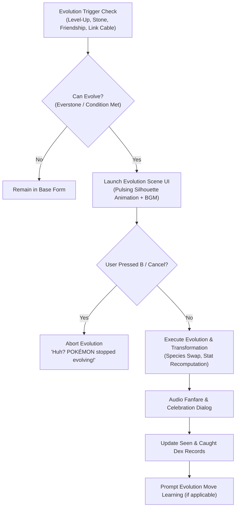

# Crystal Overdrive — System Architecture & Technical Specifications

**Version:** 0.3.0 (Phase 3 Complete)  
**Engine:** PixiJS v8 + TypeScript 5.x + Vite  
**Target Platform:** Modern Web Browsers (WebGL 2.0 / WebGPU)

---

## 0. Agent Semantic Routing Index (1-Hop File Lookup Table)

To eliminate exploratory agent searches (`grep`, `find`, directory walking) and maximize token ergonomics across the multi-agent development pipeline, every subsystem, domain contract, regional data module, and modal renderer is mapped below. Every module strictly adheres to the **Single-Window File Ceiling (< 800 lines)**.

| Subsystem / Domain | Target Capability / Feature / NPC / Mechanic | Owning File Path | Line Ceiling (<800) |
| :--- | :--- | :--- | :---: |
| **Pokemon Domain Contracts** | Entities, base stats, moves, evolutions, roamer state, and storage | `src/types/pokemon.d.ts` | < 150 lines |
| **Map Domain Contracts** | Direction, sprites, warps, wild encounters, items, and radar pings | `src/types/map.d.ts` | < 150 lines |
| **Options & Save Contracts** | Game options, save previews, player profiles, and mission schemas | `src/types/optionsAndSave.d.ts` | < 150 lines |
| **Unified Game Types Barrel** | Backward-compatible re-exports for pokemon, map, and options/save | `src/types/game.ts` / `src/types/game.d.ts` | < 45 lines |
| **Battle Execution Context** | BattleTriggerOptions and BattleSessionContext interface contracts | `src/types/battleContext.d.ts` | < 150 lines |
| **Overworld Execution Context** | Transition, interaction, ticker, and trainer sight context contracts | `src/types/worldContext.d.ts` | < 150 lines |
| **Unified Game Context Barrel** | Backward-compatible re-exports for battleContext and worldContext | `src/types/gameContext.d.ts` | < 45 lines |
| **Pure Battle Engine Facade** | Turn order, priority, status effects, damage calculations, stat stages | `src/battle/BattleStateMachine.ts` | < 750 lines |
| **Battle Move & Item Executor** | Spread moves, residuals, weather multipliers, move execution, item effects | `src/battle/state/BattleMoveAndItemExecutor.ts` | < 600 lines |
| **Battle Session Controller** | Wild battles, trainer duels, 2v2 double battles, pacing, learnsets | `src/battle/BattleSessionController.ts` | < 550 lines |
| **Damage Calculator** | Gen 4+ Physical/Special split, STAB, type effectiveness, crits | `src/battle/DamageCalculator.ts` | < 350 lines |
| **Pokemon Factory & Dex** | Level caps, EXP formulas, IV/DV generation, starter hydration | `src/battle/PokemonFactory.ts` | < 700 lines |
| **Stadium Cup Manager** | 2v2 Double Battle Cup tournaments, Item Clause, Challenger AI | `src/battle/StadiumArenaManager.ts` | < 500 lines |
| **Grid Physics & Motion** | 1x/2x/3x speed, tile collisions, ledges, trainer vision, zero-alloc loop | `src/world/GridPhysics.ts` | < 550 lines |
| **Map Engine Facade** | Binary `.blk` maps, streaming, collision queries, encounter rolling | `src/world/MapManager.ts` | < 750 lines |
| **Map Classification & Warp Rules** | Outdoor/cave/dungeon classification, carpet warps, transition contexts | `src/world/map/MapClassificationAndWarpRules.ts` | < 350 lines |
| **Early Johto Missions** | Canonical missions M01–M10 (New Bark to Slowpoke Well) | `src/world/missions/earlyJohtoMissions.ts` | < 600 lines |
| **Mid-to-Late Missions Facade** | Missions M11–M15 & Early Side Quests S01–S05 | `src/world/missions/midToLateJohtoMissions.ts` | < 450 lines |
| **Late Johto & League Quests** | Side Missions S06–S21, Mt. Silver & Kanto prerequisites | `src/world/missions/lateJohtoAndLeagueMissions.ts` | < 450 lines |
| **Mission Data Barrel Facade** | Compact re-export of `CANONICAL_MISSIONS` and `createDefaultMissions()` | `src/world/missionData.ts` | < 50 lines |
| **Roaming Beast Engine** | Markov beast adjacency graph, Entei/Raikou/Suicune roamer hops | `src/world/RoamingManager.ts` | < 300 lines |
| **Overworld World State** | Day-Care breeding, Kurt Apricorn crafting, Bug-Catching Contests | `src/world/WorldState.ts` | < 450 lines |
| **$O(1)$ NPC Field Router** | Universal NPC facing talk actions, dialogue trees, shopkeepers | `src/world/interactions/npcRouter.ts` | < 500 lines |
| **$O(1)$ Gym Leader Router** | Johto Gym Leader battles, badge awards, TM rewards | `src/world/interactions/gymLeaderRouter.ts` | < 450 lines |
| **$O(1)$ Day-Care Router** | Route 34 Day-Care breeding dialogues, compatibility, egg retrieval | `src/world/interactions/dayCareRouter.ts` | < 350 lines |
| **$O(1)$ Story Script Router**| Elm's Lab starter choice, Togepi Egg delivery, narrative gates | `src/world/interactions/storyScriptRouter.ts` | < 400 lines |
| **$O(1)$ Warp Transition Router** | Doorways, cave holes, ladders, reciprocal threshold alignments | `src/world/interactions/warpTransitionRouter.ts` | < 350 lines |
| **$O(1)$ Field Obstacle Router** | Cut trees, Rock Smash boulders, Headbutt trees, fruit trees | `src/world/interactions/fieldObstacleRouter.ts` | < 400 lines |
| **NPC Shared Helpers** | NPC builders, Guide Gent tour legs, Day-of-Week siblings logic | `src/world/npcs/npcShared.ts` | < 450 lines |
| **New Bark to Sprout Tower NPCs** | New Bark, Route 29, Cherrygrove, Routes 30/31, Sprout Tower | `src/world/npcs/newBarkToSproutTowerNpcs.ts` | < 650 lines |
| **Violet to Union Cave NPCs** | Violet City, Violet Gym, Route 32, Ruins of Alph, Union Cave, Route 33 | `src/world/npcs/violetToUnionCaveNpcs.ts` | < 700 lines |
| **Azalea to Ilex Forest NPCs**| Azalea Town, Azalea Gym, Slowpoke Well, Ilex Forest | `src/world/npcs/azaleaToIlexNpcs.ts` | < 600 lines |
| **Goldenrod Overworld NPCs** | Route 34, Goldenrod City streets, Goldenrod Underground | `src/world/npcs/goldenrodCityNpcs.ts` | < 650 lines |
| **Goldenrod Buildings & Park**| Dept Store 1F-6F, Radio Tower, Gym, National Park, Routes 35/36 | `src/world/npcs/goldenrodBuildingsAndParkNpcs.ts` | < 750 lines |
| **Ecruteak to Route 39 NPCs**| Route 37, Ecruteak City, Gym, Burned/Tin Towers, Routes 38/39 | `src/world/npcs/ecruteakToRoute39Npcs.ts` | < 700 lines |
| **Olivine to Indigo NPCs** | Olivine, Lighthouse, Cianwood, Mahogany, Blackthorn, League | `src/world/npcs/olivineToIndigoNpcs.ts` | < 750 lines |
| **NPC Data Aggregator Facade**| Backward-compatible barrel exports, `createNpcsByMap()`, `npcsByMap` | `src/world/npcData.ts` | < 250 lines |
| **East Johto Generated NPCs** | Object event dialogue and trainer teams for East & Early Johto | `src/world/generated-npcs/eastJohtoGeneratedNpcs.ts` | < 300 lines |
| **Central Johto Generated NPCs** | Object event dialogue and trainer teams for Central & Goldenrod | `src/world/generated-npcs/centralJohtoGeneratedNpcs.ts` | < 300 lines |
| **West & North Johto Generated NPCs** | Object event dialogue and trainer teams for West & North Johto | `src/world/generated-npcs/westAndNorthJohtoGeneratedNpcs.ts` | < 300 lines |
| **Generated NPCs Barrel Facade** | Unified `GENERATED_NPCS` aggregator and `GeneratedNpc` interface contract | `src/world/generatedNpcs.ts` | < 35 lines |
| **Start Menu Drawer Facade** | Keyboard shortcuts, tactile menu drawer shell, sub-modal facade | `src/ui/StartMenuUI.ts` | < 700 lines |
| **Pokédex Species Data** | 251 Johto/Kanto species telemetry, BST, mass, types, base stats | `src/ui/start-menu/pokedexData.ts` | < 350 lines |
| **Pokédex Modal Renderer** | 3-pane Neo-Kanto Pokédex workstation, habitat tracker, search/filter | `src/ui/start-menu/PokedexModalRenderer.ts` | < 650 lines |
| **Trainer Card & Save Renderer**| Holographic Johto ID card, 8-badge dock, save progress modal | `src/ui/start-menu/TrainerCardAndSaveRenderer.ts` | < 450 lines |
| **Settings Modal Renderer** | Neo-Kanto System Config tabs (Audio, Gameplay, Graphics, Controls) | `src/ui/start-menu/SettingsModalRenderer.ts` | < 600 lines |
| **Settings Controls Binding** | Event listeners for speed toggles, CRT, 8-bit APU, Exp Share, palettes | `src/ui/start-menu/SettingsControlsBinding.ts` | < 450 lines |
| **Party Management UI** | 6-slot party roster, item hold/take, move reordering, speed scaling | `src/ui/PartyManagementUI.ts` | < 480 lines |
| **Party Styles & Summary Vector** | Neo-Kanto party CSS stylesheet and summary modal HTML vector generator | `src/ui/styles/partyStylesAndSummary.ts` | < 500 lines |
| **Ruins Puzzle Modal UI** | Ruins of Alph 4x4 sliding tile puzzle logic and completion validation | `src/ui/RuinsPuzzleModalUI.ts` | < 430 lines |
| **Ruins Puzzle Styles** | Ruins of Alph sliding tile puzzle modal CSS stylesheet and responsive rules | `src/ui/styles/ruinsPuzzleStyles.ts` | < 500 lines |
| **Bag & Mart UI Facade** | Multi-pocket Bag (Items, Balls, Key Items, TMs), Poké Mart shop | `src/ui/BagAndMartUI.ts` | < 700 lines |
| **Bag Item Catalogs** | Catalogs for medicine, repels, Pokéballs, infinite TMs, stones | `src/ui/bag/BagItemCatalogs.ts` | < 400 lines |
| **Bag Party Target Renderer** | Inline party selector, stone evolutions, medicine/repel usage | `src/ui/bag/BagPartyTargetRenderer.ts` | < 400 lines |
| **Bag TM Tab Renderer** | Infinite TM compatibility party viewer, Move Replacement integration | `src/ui/bag/BagTMTabRenderer.ts` | < 400 lines |
| **Poké Mart Renderer** | Badge-gated Poké Mart inventory, buy/sell transactions, ball catalog | `src/ui/bag/PokeMartRenderer.ts` | < 300 lines |
| **Box Management UI** | Unbound-style 14-box PC storage grid, 1-click pick/swap inspector | `src/ui/BoxManagementUI.ts` | < 700 lines |
| **Box Styles & Release Modal** | Box CSS tokens, release confirm modal, detail inspector, slot renderers | `src/ui/box/BoxStylesAndReleaseModal.ts` | < 500 lines |
| **Mission Log UI** | Quests (Main & Side), rewards, dossier inspection, objective checklist | `src/ui/MissionLogUI.ts` | < 600 lines |
| **Town Map & Roamer Radar** | Interactive Johto/Kanto map, fly landmarks, Legendary Beast radar | `src/ui/TownMapUI.ts` | < 600 lines |
| **Town Map Styles & Inspector** | Neo-Kanto HUD styles, SVG topology, interactive nodes, inspector telemetry | `src/ui/town-map/TownMapStylesAndInspectorRenderer.ts` | < 500 lines |
| **Johto Cartography & POIs** | 16x14 Johto regional landmark topology, connections, radar coordinates | `src/world/townMapData.ts` | < 500 lines |
| **Town Map Resolvers & Radar** | Map ID to landmark resolution, BFS distance hops, species wild habitats | `src/world/map/townMapResolvers.ts` | < 400 lines |
| **Title Screen UI Facade** | Crystalline Title Screen, Audio Unlock Gate, SavePreview Card | `src/ui/TitleScreenUI.ts` | < 700 lines |
| **Title Screen Modals & Styles** | Title particle animation, Overwrite Confirmation & Options modals | `src/ui/title/TitleScreenModalsAndStyles.ts` | < 600 lines |
| **Intro Sequence UI Facade** | Prof. Oak introduction 6-stage machine, boy/girl selection, character creation | `src/ui/IntroSequenceUI.ts` | < 750 lines |
| **Intro Stage Renderers & Styles** | Spotlight dais, gender cards, QWERTY keyboard, RTC clock & shrink ray | `src/ui/intro/IntroStageRenderersAndStyles.ts` | < 600 lines |
| **Evolution Scene UI Facade** | Fullscreen metamorphosis, oscillation engine, B-button cancel guardrail | `src/ui/EvolutionSceneUI.ts` | < 750 lines |
| **Evolution Scene DOM & Handlers**| Dais arena, celebration card, stat deltas, responsive stage container | `src/ui/evolution/EvolutionDomAndStyles.ts` | < 250 lines |
| **Evolution Scene Styles** | Responsive CSS stylesheet, animations, and keyframes for Evolution | `src/ui/styles/evolutionStyles.ts` | < 500 lines |
| **Overworld HUD Facade** | D-Pad / Analog Joystick overlay, A/B buttons, header telemetry | `src/ui/OverworldHUD.ts` | < 700 lines |
| **Overworld Touch & Key Controller** | Touch D-Pad / Joystick event routing, keyboard listeners, direction state | `src/ui/hud/OverworldTouchAndKeyController.ts` | < 400 lines |
| **Overworld Cutscene & Pokegear Modals** | Starter choice modal, Pokémon Center healing tray, field rest, roamer radar | `src/ui/hud/OverworldCutsceneAndPokegearModals.ts` | < 450 lines |
| **Battle HUD Facade** | Neo-Kanto battle dialogue, move cards, HP/EXP bars, type badges | `src/ui/BattleHUD.ts` | < 750 lines |
| **Battle Catalogs & Stage Badges** | Battle item catalog, type/status colors, stat stage badge generators | `src/ui/battle/BattleItemCatalogAndStyles.ts` | < 230 lines |
| **Battle HUD Keyframes & Template**| Keyframe animations and HTML vector template for the Battle HUD | `src/ui/styles/battleHudStyles.ts` | < 500 lines |
| **Battle Bag & Party Sub-Modal** | In-battle medicine/items/ball use, mid-battle party switch menu | `src/ui/battle/BattleBagAndPartySubModal.ts` | < 500 lines |
| **Battle Move Menu & Modal** | 2x2 move matrix, tactical tooltips, 2v2 targeting, move forget prompt | `src/ui/battle/BattleMoveMenuAndForgetModal.ts` | < 600 lines |
| **PixiJS Overworld Render Facade** | 64x64 Metatiles, view frustum culling, daylight tint shaders | `src/render/OverworldRenderer.ts` | < 750 lines |
| **Overworld NPC & Item Sprites** | NPC sprite texture cache, character frames, overworld item balls & fruit trees | `src/render/OverworldNpcAndItemSprites.ts` | < 700 lines |
| **Overworld Particle & VFX Pool** | Zero-GC graphic particle pool, grass rustle, cut slash, doorway fade veil | `src/render/OverworldParticleAndVfxPool.ts` | < 400 lines |
| **PixiJS Battle Render Facade** | 2.5D layered arena, GSAP battle animations, particle VFX | `src/render/BattleRenderer.ts` | < 600 lines |
| **Battle Pokeball & Switch VFX** | Parabolic Pokeball toss, switch recall, faint collapse, capture shake | `src/render/BattlePokeballAndSwitchAnimations.ts` | < 450 lines |
| **Overworld Warp & Map Transition** | Async tile texture hydration, reciprocal warps, story mutations, black veil sync | `src/world/OverworldWarpAndMapTransitionController.ts` | < 650 lines |
| **Trainer Sight & Walking Tour** | Line-of-sight trigger, rewards, stadium duels, Guide Gent tour | `src/world/OverworldTrainerSightAndTourController.ts` | < 550 lines |
| **Overworld Ticker & Itemfinder** | Zero-alloc ticker hot paths, player bump, neighbor NPC wander, radar sonar | `src/world/OverworldTickerCoordinator.ts` | < 600 lines |
| **Overworld Modal Registry** | Lazy modal instantiations, sub-modal lifecycle, shortcut handling | `src/ui/OverworldModalRegistry.ts` | < 550 lines |
| **Main Application Bootstrapper** | Core engine initialization, state coordination, input dispatch | `src/main.ts` | < 750 lines |
| **Audio Engine Facade** | 8-bit APU chiptune emulation, Web Audio API, authentic cry synthesis | `src/audio/BattleAudio.ts` | < 650 lines |
| **Overworld & Environmental Audio** | Warp sounds, footsteps, itemfinder sonar, status sounds, weather | `src/audio/battle/OverworldAndEnvironmentalAudio.ts` | < 650 lines |
| **Seamless BGM Audio Manager** | WebM/MP3 loop streaming, map crossfades, battle ducking, chiptune mode | `src/audio/AudioManager.ts` | < 500 lines |
| **Johto & Kanto Map BGM Table** | Universal mapping of Johto/Kanto locations & battle types to BGM tracks | `src/audio/mapBgmTable.ts` | < 400 lines |

---

## 1. Executive Overview & Core Architectural Pillars

**Crystal Overdrive** is a high-performance, browser-based recreation of *Pokémon Crystal* designed with an authentic Johto world, modernized Gen 4+ battle mechanics, and zero-allocation game loops.

```mermaid
flowchart TD
    subgraph UI_Layer["UI & Presentation Layer (HTML5 / CSS3 DOM)"]
        TSUI["TitleScreenUI"]
        ISUI["IntroSequenceUI"]
        OHUD["OverworldHUD"]
        BHUD["BattleHUD"]
        SM["StartMenuUI"]
        PM["PartyManagementUI"]
        BM["BagAndMartUI"]
        BMUI["BoxManagementUI"]
        MLUI["MissionLogUI"]
        DCUI["DayCareModalUI"]
        DSEUI["DeptStoreElevatorUI"]
        RTQUI["RadioTowerQuizUI"]
    end

    subgraph Render_Layer["Render Layer (PixiJS v8 WebGL/WebGPU)"]
        OR["OverworldRenderer (64x64 Metatiles, Viewport Culling, Daytime Tint)"]
        BR["BattleRenderer (2.5D Layered Arena, Particles, Sprites, GSAP)"]
    end

    subgraph Pure_Logic["Pure TypeScript Engine (Zero DOM / Zero PixiJS Dependencies)"]
        GC["GameClock (Decoupled 1x/2x/3x/4x)"]
        GP["GridPhysics (Zero-Alloc, Ledge Hop, Trainer Sight)"]
        MM["MapManager (pret/pokecrystal .blk & Warps)"]
        RM["RoamingManager (Markov Beast Adjacency)"]
        BSM["BattleStateMachine (Turn Order, Statuses, Residuals)"]
        DC["DamageCalculator (Gen 4+ Split, Stage Multipliers)"]
        PF["PokemonFactory (Showdown Dex, EXP & Leveling)"]
        SMAN["SaveManager (IndexedDB / LocalStorage)"]
        EB["EventBus (Decoupled Pub/Sub)"]
        STM["StorageManager (14-Box PC Storage Grid)"]
        EVM["EvolutionManager (Levels, Stones, Link Cable)"]
        OIM["OverworldItemManager (Balls, Hidden, Trees)"]
        MSM["MissionManager (Main & Side Quests)"]
        DCM["DayCareManager (2 Slots, Compatibility, Fee Formula, Eggs)"]
        BSC["BattleSessionController (Wild, Trainer, Roamer, 2v2 Pacing & Learnsets)"]
        FOD["FieldObstacleDispatcher (Signs, Cut, Surf, Altars, Item Balls)"]
    end

    subgraph Audio_Layer["Audio Layer (Howler.js & Web Audio API)"]
        AM["AudioManager (BGM Crossfading, Battle Ducking, Mute Sync)"]
        BA["BattleAudio (Synthesized 8-Bit Cries, Cues, Fanfares)"]
    end

    UI_Layer --> Pure_Logic
    Render_Layer --> Pure_Logic
    Pure_Logic --> Audio_Layer
```



### Core Architectural Pillars
1. **Strict Separation of Concerns:**
   - Modules in `src/core/`, `src/world/`, and `src/battle/` are **pure TypeScript** with zero imports from `pixi.js` or the browser DOM. This guarantees 100% headless testability in Vitest.
   - `src/render/` handles all GPU canvas operations.
   - `src/ui/` renders vector DOM overlays for crisp high-DPI typography and flexible layouts.
2. **Decoupled Speed Scaling (`1x` / `2x` / `3x` / `4x Overdrive`):**
   - **World Clock (`1.0x` fixed):** Ambient water animations, NPC wander steps, and time-of-day transitions always progress at real-time 1.0x speed.
   - **Player Movement (`1x | 2x | 3x | 4x`):** Player movement speed scales by `playerSpeedMultiplier` using fractional progress overflow chaining so fast movement never clips collision boundaries.
   - **Battle Speed (`1x | 2x | 3x | 4x`):** All battle animations, HP bar drain tweens, and typewriter text delays divide by `battleSpeedMultiplier`.
3. **Zero-Allocation Physics & Rendering:**
   - The game loop avoids garbage collection spikes by reusing coordinate scratch objects, array iterators, and continuous interpolation math.

---

## 2. Directory Structure & Module Boundaries

```
src/
├── core/                  # Engine Foundation & Cross-Cutting Concerns
│   ├── GameClock.ts       # Decoupled timekeeper (world vs player vs battle speed)
│   ├── EventBus.ts        # Typed pub/sub event emitter
│   └── SaveManager.ts     # SaveState serialization & localStorage persistence
├── world/                 # Overworld Mechanics & Spatial Partitioning
│   ├── GridPhysics.ts     # Collision detection, ledges, and trainer line-of-sight
│   ├── MapManager.ts      # Binary map loader (.blk), seamless neighbor connections
│   ├── RoamingManager.ts  # Markov transition adjacency for Raikou, Entei, Suicune
│   ├── ItemfinderRadar.ts # Pure TS 8-tile dowsing compass radar & dynamic sonar math
│   ├── OverworldItemManager.ts # Field item balls, hidden items, and fruit tree daily harvest
│   ├── MissionManager.ts  # 15 Main & 21 Side quest tracking and step progression
│   ├── StorageManager.ts  # 14-box Pokémon storage engine (280 slots) with catch auto-deposit
│   ├── EvolutionManager.ts # Pure domain evolution logic (levels, stones, Link Cable, friendship)
│   └── npcData.ts         # Canonical Johto NPC & Trainer placements across all maps
├── battle/                # Turn-Based Tactical Combat System
│   ├── BattleStateMachine.ts # Round execution, turn-order resolution, and residuals
│   ├── DamageCalculator.ts   # Gen 4+ split, STAB, criticals, stat stages (-6 to +6)
│   ├── PokemonFactory.ts     # Showdown Dex integration, EXP gain, level-up calculation
│   ├── CatchCalculator.ts    # Gen 2 & Gen 4 Pokeball catch probabilities
│   └── EffectivenessHelper.ts # Live Unbound-style type multiplier badges, hit shake specs, and ball palettes
├── render/                # GPU Canvas Graphics (PixiJS v8)
│   ├── OverworldRenderer.ts  # 64x64 tiles, tall grass tufts, day/night tints, culling
│   └── BattleRenderer.ts     # 2.5D stage, custom Pokeball arcs, Physical/Special hit FX, camera shakes
├── ui/                    # Vector DOM Overlays & Interactivity (100dvh + Safe-Area Inset Aware + Device-Adaptive)
│   ├── TitleScreenUI.ts      # Crystalline Title Screen, Audio Unlock Gate, SavePreview Card, Overwrite & Options Modals
│   ├── IntroSequenceUI.ts    # 6-Stage Prof. Oak Intro, Authentic Marill Sprite, Gender Select (Boy/Girl), 15-Char Name Input & Presets, RTC Sync
│   ├── NamingModalUI.ts       # Centered Rival naming modal with presets (SILVER, KAZU, KAMON, RED) & 15-char input
│   ├── OverworldHUD.ts       # Device-adaptive top menu capsule, Elevated Mobile Touch Gamepad, story-gated Roamer radar, dialogue typewriter
│   ├── ItemfinderHUD.ts      # Top-right floating Itemfinder dowsing compass capsule with rotating needle & gold lock-on state
│   ├── MissionLogUI.ts       # Unbound-style mission tracker with categorized tabs and objective steps
│   ├── BoxManagementUI.ts    # Split-view Bill's PC 14-box storage grid & party transfer manager
│   ├── BattleHUD.ts          # Asymmetrical HUD cards, 6-dot party dock, device-adaptive Unbound 2x2 move matrix & hotkeys
│   ├── StartMenuUI.ts        # Classic start menu (Pokedex, Pokemon, Bag, Save)
│   ├── PartyManagementUI.ts  # Full party inspector, lead reordering, summaries
│   └── BagAndMartUI.ts       # Progressive Mart inventory, out-of-battle medicine
├── audio/                 # Audio Engine
│   ├── AudioManager.ts       # Seamless BGM crossfader (.webm/.mp3), battle ducking, and mute persistence
│   └── BattleAudio.ts        # Pure Web Audio synthesized 8-bit cries and sound effects
└── types/                 # Shared Data Models & Interfaces
    └── game.d.ts          # Strongly-typed schemas for maps, entities, and battle state
```

---

## 3. Core Data Schemas & State Models

### 3.1 Pokémon Instance (`src/types/game.d.ts`)
```typescript
export interface PokemonInstance {
  uid: string;
  speciesId: string;
  nickname: string;
  level: number;
  types: [PokemonType] | [PokemonType, PokemonType];
  baseStats: BaseStats;
  stats: BaseStats;
  currentHp: number;
  status: StatusCondition;      // 'NONE' | 'PAR' | 'SLP' | 'FRZ' | 'BRN' | 'PSN' | 'TOX'
  sleepTurns?: number;          // 1-3 turns for SLP condition
  statStages?: StatStages;      // -6 to +6 stages for atk, def, spa, spd, spe, acc, eva
  exp?: number;
  nextLevelExp?: number;
  isTrapped: boolean;
  moves: Array<{ moveId: string; currentPp: number; maxPp: number }>;
  catchRate: number;
  isEgg?: boolean;
  eggSteps?: number;
}
```

### 3.2 Overworld Map Data (`public/assets/data/maps/*.json`)
```typescript
export interface MapData {
  id: string;
  name: string;
  width: number;
  height: number;
  tileMap?: string[];           // Array of 64x64 metatile IDs (length = width * height)
  collisionGrid: number[][];    // 0 = Walkable, 1 = Solid, 2 = Tall Grass, 3 = Water, 4 = Ledge DOWN, 5 = Ledge UP, 6 = Ledge LEFT, 7 = Ledge RIGHT
  warps: WarpEvent[];           // Warp triggers to interior/exterior maps
  entities: EntitySpawn[];      // NPC spawns with dialogue, direction, and sight range
  wildEncounters?: WildEncounterTable; // Morning, Day, and Night spawn tables
  connections?: {               // Seamless multi-map rendering connections
    north?: { mapId: string; offset: number };
    south?: { mapId: string; offset: number };
    east?: { mapId: string; offset: number };
    west?: { mapId: string; offset: number };
  };
}

export type NpcSpriteType =
  | 'boy' | 'girl' | 'fat_man' | 'kris'
  | 'silver' | 'fisherman' | 'bug_catcher' | 'teacher' | 'mom' | 'prof_elm'
  | 'sage' | 'elder' | 'elder_li' | 'falkner' | 'bird_keeper' | 'earl' | 'oak';
```

### 3.3 Overworld Items & Scattered Pickups (`public/assets/data/overworld_items.json`)
Authentic extraction of all 246 scattered overworld pickups from Pokémon Crystal (`scripts/pokecrystal_raw/maps__*.asm`):
- **136 Visible Item Balls** (`OBJECTTYPE_ITEMBALL`): Parsed directly with event flag mappings.
- **80 Hidden Items** (`BGEVENT_ITEM`): Parsed from background event triggers with flags.
- **30 Fruit Trees** (`SPRITE_FRUIT_TREE` / `fruittree`): Parsed and resolved against `data/items/fruit_trees.asm` berry tables.
- **Indexed Structure**: Includes overall and regional summary stats (Johto: 173 items, Kanto: 73 items), flat category arrays, and an O(1) `byMap` index containing map-scoped item balls, hidden items, and fruit trees.

```typescript
export interface OverworldItemsPayload {
  summary: {
    totalItemBalls: number;    // 136
    totalHiddenItems: number;  // 80
    totalFruitTrees: number;   // 30
    total: number;             // 246
    totalMapsWithItems: number;// 93
    johto: { itemBalls: 103, hiddenItems: 48, fruitTrees: 22, total: 173 };
    kanto: { itemBalls: 33, hiddenItems: 32, fruitTrees: 8, total: 73 };
  };
  itemBalls: ItemBallEntry[];
  hiddenItems: HiddenItemEntry[];
  fruitTrees: FruitTreeEntry[];
  byMap: Record<string, {
    mapId: string;
    region: 'johto' | 'kanto';
    itemBalls: ItemBallEntry[];
    hiddenItems: HiddenItemEntry[];
    fruitTrees: FruitTreeEntry[];
  }>;
}
```

### 3.4 Roaming Beast Markov Graph (`src/world/RoamingManager.ts`)
The three legendary beasts (*Raikou*, *Entei*, *Suicune*) stay dormant in Ecruteak's Burned Tower until awakened by story events. Once active, their positions transition across an adjacency graph upon player route transitions:
- $P(\text{Stay}) = 0.50$
- $P(\text{Move to Adjacent Route}) = 0.35$
- $P(\text{Converge toward Player}) = 0.15$

### 3.4 Save State, Options & Title Preview (`src/core/SaveManager.ts`, `src/types/game.d.ts`)
```typescript
export type PlayerGender = 'BOY' | 'GIRL';

export interface GameOptions {
  soundVolume: number;      // 0.0 - 1.0 (default: 0.7)
  bgmVolume: number;        // 0.0 - 1.0 (default: 0.7)
  textSpeed: 'SLOW' | 'MID' | 'FAST' | 'INSTANT'; // (default: 'MID')
  battleAnimations: boolean; // (default: true)
  playerSpeedDefault: SpeedMultiplier; // (default: 1)
}

export interface SavePreview {
  playerName: string;
  gender: PlayerGender;
  badgeCount: number;
  pokedexCount: number;
  playTimeFormatted: string; // "HH:MM" e.g. "01:24"
  currentLocationName: string; // e.g. "Player's House" or "New Bark Town"
  partyLeadSpeciesId?: string;
  partyLeadLevel?: number;
  timestamp: number;
}
```

---

## 4. Key Engine Lifecycles

### 4.1 Grid Movement & Fractional Overflow
In `GridPhysics.updateEntity`:
1. When input is held, the entity selects a target tile $(x + \Delta x, y + \Delta y)$.
2. Progress $p$ advances:
   $$p \leftarrow p + \frac{\Delta t \cdot \text{speedMultiplier}}{\text{BASE\_TRAVERSAL\_TIME}}$$
3. If $p \ge 1.0$, the entity snaps to $(x, y) = (\text{targetX}, \text{targetY})$, triggers `onTileEntered`, and chains any fractional overflow:
   $$\text{overflow} = p - 1.0$$
4. Render coordinates interpolate smoothly:
   $$\text{renderX} = x + (\text{targetX} - x) \cdot p$$

### 4.2 Multi-Directional Ledge Hopping Mechanics
When facing a Ledge tile in its permitted traversal direction (`collision === 4 (DOWN)`, `5 (UP)`, `6 (LEFT)`, `7 (RIGHT)`):
1. Destination is checked 2 tiles ahead in the movement direction $(x + 2\Delta x, y + 2\Delta y)$.
2. If walkable and unoccupied, a 2-tile parabolic jump is executed:
   - For vertical hops (DOWN/UP): $\text{renderY} = y + 2\Delta y \cdot p - 16 \cdot \sin(\pi \cdot p)$
   - For horizontal hops (LEFT/RIGHT): $\text{renderX} = x + 2\Delta x \cdot p, \quad \text{renderY} = y - 16 \cdot \sin(\pi \cdot p)$
3. An elliptical ground shadow is drawn at ground level during the arc, and `BattleAudio.playOverworldSound('HOP')` plays.

### 4.3 Battle Turn Event Stream
`BattleStateMachine.executeRound` processes round inputs (`FIGHT`, `BAG`, `SWITCH`, `RUN`) and returns a deterministic event stream:
- `ATTACK` -> `DAMAGE` -> `STAT_CHANGE` -> `STATUS` -> `RESIDUAL_DAMAGE` -> `FAINT`
- Battle UI and Renderer consume events sequentially with time-scaled async tweens.

### 4.4 Synchronized Map & NPC Lifecycle (1:1 Hydration, Transition Preload & LRU Eviction)
`MapManager` and `OverworldRenderer` synchronize map loading and NPC lifecycle in 1:1 lockstep across 4 phases (TICKET-ARCH-NPC-SPAWN-MAP-LIFECYCLE-SYNC-01):
1. **1-Hop Zone Hydration (`MapManager.ensureZoneAndConnectionsLoaded`)**:
   - Lazily loads active map + 1-hop cardinal neighbors (`NORTH`, `SOUTH`, `EAST`, `WEST`) and preloads direct warp targets.
   - Triggers `onMapLoaded` callback which deterministically runs `applyMapNpcStoryMutations` to filter story-state NPCs and reset origin coordinates.
2. **Transition Veil Preload Guarantee (`alpha === 1.0`)**:
   - `OverworldRenderer.ensureMapTilesLoaded` collects both missing tile textures AND all `NpcSpriteType` character sheets required across the active map and its 1-hop connected neighbors.
   - Holds the opaque doorway fade veil (`alpha = 1.0`) until 100% of tile textures and NPC sprite sheets are buffered in GPU memory, preventing fallback `'boy'` pop-in.
3. **Synchronous Scene Graph Spawning (`OverworldRenderer.renderMap`)**:
   - Synchronously instantiates and positions `Sprite` and tall-grass `Graphics` masks via `spawnMapNpcs` before the veil lifts, guaranteeing zero new object allocations in the steady-state 60 FPS overworld ticker.
4. **1:1 LRU Eviction Sync (`MapManager.evictDistantMaps` & `ActiveNpcCache.evictMapsNotIn`)**:
   - Caps resident maps at `MAX_RESIDENT_MAPS = 16`, protecting the active map, 1-hop neighbors, and direct warp targets.
   - Evicting distant maps triggers `onMapEvicted` and `ActiveNpcCache.evictMapsNotIn`, while `OverworldRenderer.evictDistantTileTextures` and `evictDistantNpcSprites` cleanly unmount distant NPC sprites.

---

## 5. Architectural Invariants & Verification Guardrails

Every code addition and pull request must strictly honor these five non-negotiable invariants:

1. **Strict Layer Isolation (Pure Logic vs. Render/UI):**
   - `src/core/`, `src/world/`, and `src/battle/` must remain **100% pure TypeScript logic**.
   - Zero imports from `pixi.js`, `@pixi/*`, or browser DOM APIs (`window`, `document`, `HTMLElement`).
   - Renderers (`src/render/`) and UI overlays (`src/ui/`) consume core events and state, never the reverse.
2. **Decoupled Player Speed & Collision Boundary Integrity:**
   - World clock (`GameClock.ts`) runs at fixed `1.0x` for NPC wandering, ambient animations, and roamer updates.
   - Player speed multiplier (`1x | 2x | 3x`) accelerates player movement and step cycles via normalized progress $p \in [0.0, 1.0]$.
   - Physics updates must use **fractional overflow chaining** (`accumulator -= stepTime`) so $3x$ speed never tunnels through or overshoots collision boundaries.
3. **Flat, Schema-Pure, JSON-Serializable State:**
   - All state stored in `SaveManager.ts` and defined in `src/types/game.d.ts` must be completely serializable (no circular structures, functions, Map/Set instances, or Pixi object references).
   - Guarantees asynchronous IndexedDB (`idb`) and `localStorage` persistence and compatibility with automated world parsing.
4. **Authentic Gen 4+ Battle & Catch Formula Fidelity:**
   - Gen 4+ Physical / Special / Status split (`move.category`).
   - Showdown-accurate damage formula with STAB ($1.5\times$), critical hits, weakness/resistance scaling, and deterministic $0.85$–$1.00$ damage rolls.
   - Status multipliers in catch calculations strictly calibrated: `SLEEP` / `FREEZE` = $2.0\times$, `PARALYSIS` / `POISON` / `BURN` = $1.5\times$.
   - Roaming beasts enforce a mandatory 2-turn grace window before attempting to flee (unless trapped by Mean Look / Block).
5. **Type Effectiveness UI Contract:**
   - Move effectiveness against active target must compute in real-time and produce verified UI classifications: `4x ULTRA`, `2x SUPER`, `1x NORMAL`, `0.5x / 0.25x NOT VERY`, and `0x IMMUNE`.
6. **Boundary Protection & Unmapped Area Guard:**
   - Warp callbacks and map transitions must validate that target map assets exist before triggering camera fades or coordinate mutations. Unmapped boundaries (e.g. gates to future cities, unlit caves) must be barred with canonical roadblock NPCs or solid collisions to prevent players from walking into unrendered space.

---

## 6. QA Verification Matrix & Test Standards

* **Test Framework:** Vitest (`vitest run`), configured for ultra-fast, in-memory execution (~45ms baseline).
* **Test Location & Naming:** `tests/<ModuleName>.test.ts`, matching corresponding source module in `src/`.
* **Deterministic Execution:** Seeded PRNG or explicit test vectors for RNG-heavy logic (damage rolls, catch rates, roamer graph selections).
* **Periodic Optimization Review Cadence:** Every 5 to 10 completed feature implementations (e.g. after Tickets 5.1–5.5, Tickets 6.1–6.5, etc.), an automated and manual health review is run via `npm run review` (`scripts/project-optimization-review.cjs`) to audit layer purity, NPC walkability, reciprocal warps, test suite, and bundle budgets.
* **Pre-Merge / Verification Gate:**
  1. `npm test` (All Vitest suites must pass with zero warnings).
  2. `npm run build` (`tsc` strict static type-check + Vite production bundle validation).
  3. `npm run review` (Full 5-stage health and boundary audit).
  4. **Documentation Invariant:** Update `CREDITS.md` if any new external assets, audio, sprites, or tools are added.
  5. **Architecture Invariant:** Update `ARCHITECTURE.md` if any data schemas, engine lifecycles, or interfaces are modified.

### 6.1 Current Test Coverage Matrix

| Module | Test Suite File | Current Tests | Status | Scope Verified |
| :--- | :--- | :---: | :---: | :--- |
| `GameClock.ts` | `tests/GameClock.test.ts` | 7 | ✅ Covered | Default 3x player speed, battle speed capped at 3x (1/2/3 cycle), decoupled player vs world vs battle delta, pausing, time dilation, Johto TimeOfDay calculation (Morning/Day/Night), simulated hours, and ambient tint values (Ticket 6.2, TICKET-UX-BATTLE-3X-SPEED-AND-PACING-01). |
| `GridPhysics.ts` | `tests/GridPhysics.test.ts` | 19 | ✅ Covered | 1x/2x/3x speed, tile collision, bounds, fractional chaining, multi-directional 2-tile and 3-tile ledge hopping (4..9), trainer vision, wall collision bump callback, and authentic GBC directional carpet thresholds (`COLL_WARP_CARPET_DOWN`) suppressing sideways/UP moves and triggering on DOWN egress (Ticket 6.3, Sprint 08, TICKET-POLISH-AUTHENTIC-DOOR-MECHANICS-01). |
| `MapData.ts` | `tests/MapData.test.ts` | 35 | ✅ Covered | Binary map extraction schema, warp coords, reciprocal warps, Sprout Tower, Violet Gym & Falkner, Post-Gym Togepi Egg Aide, Elm's Lab starter Poké Ball `bgEvents`, table Poké Ball sprite despawn rules (`getStarterBallsForLab`), Mr. Pokémon's House Prof. Oak departure & Mystery Egg handover (`BUGFIX-NARRATIVE-01`), Route 29 roadblock (Ticket 6.1), time-of-day encounter rolling & outdoor classification (Ticket 6.2), 100% NPC walkability guard (`0`/`2`), Phase 7 South Johto, Phase 8 Goldenrod Metropolis & Day-Care Route 34, Phase 9 Central Johto, Phase 10 Western Johto, Phase 11 (Mahogany, Rocket Hideout, Lake of Rage, Ice Path, Blackthorn, Dragon's Den, Routes 42–46, Leaders Pryce & Clair), Phase 12 (Routes 26/27, Tohjo Falls, Victory Road, Routes 22/23, Indigo Plateau Elite Four & Champion Lance, Route 28, Mt. Silver & Red), Phase 13 Western & Central Kanto (Pallet Town, Viridian City, Pewter City, Cerulean City, Routes 1–4, 24–25, Leaders Brock, Misty, Blue), Phase 14 Central & Eastern Kanto (Vermilion City, Celadon City, Lavender Town, Rock Tunnel, Routes 5–11, S.S. Aqua Fast Ship, Leaders Lt. Surge & Erika), Phase 15 Southern Kanto, Saffron & Sea Routes (Saffron City, Fuchsia City, Cinnabar Island, Cycling Road, Seafoam Gym, Routes 12–21, Leaders Sabrina, Janine, Blaine), Ruins of Alph solid cave roofs & Route 36 gate reciprocal warps with optional warp facing `direction` (BUGFIX-RUINS-OF-ALPH-WARPS-COLLISION-01), Sprint 09 `world_maps.json` single-payload consolidation & retro GBC loader, and canonical GBC door transitions (`resolveWarpTransition`), outdoor doorstep landing (`targetY + 1` facing `DOWN`), debounced 320ms input lock, and dedicated audio cues (`DOOR_ENTER`, `DOOR_EXIT`, `STAIRS_STEP`, `CAVE_WARP`) (TICKET-POLISH-AUTHENTIC-DOOR-MECHANICS-01). Complete closed-loop world (315 maps). |
| `RoamingManager.ts`| `tests/RoamingManager.test.ts` | 4 | ✅ Covered | Adjacency graph traversal, route weighting, active state, Burned Tower dormancy. |
| `CatchCalculator.ts`| `tests/CatchCalculator.test.ts` | 6 | ✅ Covered | Modern Pokéball multipliers (Quick, Dusk, Net, etc.), status modifiers. |
| `DamageCalculator.ts`| `tests/DamageCalculator.test.ts`| 11 | ✅ Covered | Physical/Special split, STAB, crits, dual-type damage, stat stage modifiers (-6 to +6), Unbound pill styles & hit shake specs. |
| `PokemonFactory.ts` | `tests/PokemonFactory.test.ts` | 6 | ✅ Covered | `createEgg`, battle switch Egg guard, Togepi Lv.1 hatch, Johto Starter Lv.5 creation (Ticket 6.1), Gen 2 learnset move lookup at level, and move inspect tooltip metadata (Ticket 6.4). |
| `SaveManager.ts` | `tests/SaveManager.test.ts` | 6 | ✅ Covered | IndexedDB / localStorage serialization, `SavePreview` extraction, `GameOptions` defaults, `formatPlayTime`, legacy save migration. |
| `AudioManager.ts` | `tests/AudioManager.test.ts` | 6 | ✅ Covered | Map-to-BGM track resolution, gain staging math, battle ducking/restoration, mute sync, and retro overworld SFX (BUMP, HOP, RUSTLE, HEAL_JINGLE, FANFARE) (Ticket 6.3). |
| `TitleScreenUI.ts` | `tests/TitleScreenUI.test.ts` | 6 | ✅ Covered | Default menu focus (`CONTINUE` vs `NEW_GAME`), `SavePreview` summary binding, audio unlock gate, keyboard navigation, overwrite confirmation modal, `GameOptions` updates. |
| `IntroSequenceUI.ts` | `tests/IntroSequenceUI.test.ts` | 4 | ✅ Covered | 6-stage state machine progression, Boy/Girl preset selection, 1-15 char name validation/fallback, RTC period detection, `onComplete` payload. |
| `StartMenuUI.ts` / `BagAndMartUI.ts` / `OverworldHUD.ts` / `BattleHUD.ts` / `MissionLogUI.ts` / `ItemfinderHUD.ts` | `tests/SettingsAndMartUI.test.ts` | 19 | ✅ Covered | Settings submenu with sound toggle, speed cycle, touch controls, D-Pad vs Virtual Analog Joystick control style, and 3-state Unbound `EXP. SHARE MODE` (`OFF` / `ALL` / `CAPPED`); separate Poké Mart counter view & bag view; mobile D-pad ergonomics, dynamic Trainer Card name, P/K/B/G/M/T/S/O shortcuts, 6-slot Poké Ball healing animation at fixed canonical speed, canonical field rest blackout fade (`playFieldRestAnimation`) & top-aligned floating pill toast (`#overworld-toast-banner`), interactive `#move-learn-modal` pointer-events & keyboard shortcuts, Unbound-style `MissionLogUI`, `ItemfinderHUD` compass capsule states, and persisted `battleSpeedMultiplier` & `touchControlStyle` (Sprint 08, Sprint 10, Sprint 11, UI-HEALING-POLISH-01, KEY-ITEMS-UNBOUND-01). `BattleHUD` zero-spill 2-column move grid (`minmax(0, 1fr)`) for 440-480px phones, full-width dialogue/action tray swap, and accelerated dialogue timing (12ms/char + 500ms) decoupled from battle speed across 1x, 2x, and 3x (UI-BATTLE-ERGONOMICS-SPEED-01, TICKET-UX-BATTLE-3X-SPEED-AND-PACING-01). |
| `overworld_items.json` / `OverworldItemManager.ts` | `tests/OverworldItems.test.ts` | 11 | ✅ Covered | Authentic pret/pokecrystal scattered overworld item extraction (136 item balls, 80 hidden items, 30 fruit trees = 246 total), Johto (173) vs Kanto (73) regional integrity, valid coordinates & event flags, and `OverworldItemManager` item ball collection/despawn, solid obstacle collision (`isSolidObstacle`), hidden item detection, fruit tree daily harvest reset, Itemfinder 8-tile radar bearings, and pocket classification (Sprint 12, PC-RADAR-COLLISION-01). |
| `MissionManager.ts` / `missionData.ts` | `tests/MissionManager.test.ts` | 4 | ✅ Covered | Unbound-style quest system hydrating all 15 Main Story Missions (M01–M15) and 21 Side Missions (S01–S21), category/status filtering, sequential step progression, `checkStoryFlags` auto-unlock/completion, and lossless save state serialization (Sprint 11). |
| `PokemonFactory.ts` / `SaveManager.ts` | `tests/ExpShare.test.ts` | 5 | ✅ Covered | Unbound-style 3-mode Exp. Share (`OFF`, `ALL`, `CAPPED`), default `CAPPED` save hydration, Johto/Kanto badge level caps (`15..85`), 100% active + 50% bench party distribution, and `1 EXP` clamping at/above level cap (KEY-ITEMS-UNBOUND-01). |
| `ItemfinderRadar.ts` | `tests/ItemfinderRadar.test.ts` | 5 | ✅ Covered | Pure TypeScript 8-tile dowsing radar scan, nearest uncollected hidden item vector lock, 8-way compass bearings, adjacent `FACING` detection, and dynamic sonar pitch $f(d) = 880 + (8-d)\times 120\text{ Hz}$ (KEY-ITEMS-UNBOUND-01). |
| `NamingModalUI.ts` / `main.ts` / `npcData.ts` | `tests/RivalAndAzalea.test.ts` | 10 | ✅ Covered | Passerby Rival counter-starter selection (Cyndaquil -> Totodile, Totodile -> Chikorita, Chikorita -> Cyndaquil), dropped Trainer Card `SILVER`, Police interrogation & 15-character naming modal with presets (`SILVER`, `KAZU`, `KAMON`, `RED`), `SaveData.rivalName` serialization/hydration, Slowpoke Well Team Rocket raid with Executive Proton (Koffing Lv. 14, Zubat Lv. 9), Kurt Apricorn ball crafting unlock + Lure Ball award, Azalea Gym Leader Bugsy battle (Metapod Lv. 14, Kakuna Lv. 14, Scyther Lv. 16), Hive Badge, TM49 Fury Cutter, field Cut, and Mission M03 completion (Sprint 13). |
| `StorageManager.ts` / `BoxManager.ts` / `BoxManagementUI.ts` | `tests/BoxManager.test.ts` | 13 | ✅ Covered | 14 storage boxes of 20 slots each (280 total capacity), automatic wild catch overflow into storage with transfer dialogue and fanfare, interactive PC terminals in all Pokémon Centers and player bedroom launching `BoxManagementUI`, decoupled inspection and exclusive button-driven party-box swapping (`[ ⇄ MOVE / SWAP ]`), mobile segmented tab buffer persistence, `pointer-events: auto !important` clickability, canonical `_front.png` inspector sprites with defensive `this.onerror=null` fallbacks, release double-check safeguard, party minimum protection (cannot deposit/release last conscious Pokémon), protected Roaming Beasts (Raikou, Entei, Suicune) release protection, and backward-compatible save migration (Sprint 13.5, Stitch Neo-Kanto Protocol, TICKET-UX-STORAGE-BUTTON-ONLY-SWAP-01). |
| `BagAndMartUI.ts` / `NamingModalUI.ts` / `npcData.ts` / `main.ts` | `tests/ProgressionNarrative.test.ts` | 9 | ✅ Covered | `TMS & HMS` pocket definitions for HM05/TM70 Flash, TM31 Mud-Slap, TM49 Fury Cutter, HM01 Cut with dynamic fallback for unknown TM ids, rival naming modal clickability (`pointer-events: auto !important`), mobile-friendly input (`inputmode`, 16px font, CLEAR button), empty-name SILVER fallback, peeking `nbt_rival` despawn/shove, and authentic 1:1 Cherrygrove City Guide Gent 6-leg scripted walking tour (`GUIDE_GENT_TOUR_LEGS`, simultaneous entity stepping/following, Stop 1–5 dialogues, Map Card award, and Leg 6 door entrance & overworld despawn) (BUGFIX-PROGRESSION-NARRATIVE-02 & TICKET-EVENT-GUIDE-GENT-WALKING-TOUR-01). |
| `OverworldItemManager.ts` / `SaveManager.ts` / `main.ts` | `tests/ElmsLabStarters.test.ts` | 7 | ✅ Covered | Elm's Lab table Poké Ball states (3 -> 2 -> 1 for all three starter choices), context-aware table inspection dialogues (empty spot / stolen ball / remaining ball), HM05 Flash as the sole Flash item (TM70 removed from Elder Li reward and Bag) and legacy TM70 save pruning (TICKET-NARRATIVE-ELMS-TABLE-POKEBALLS-01). |
| `EvolutionManager.ts` | `tests/EvolutionManager.test.ts` | 20 | ✅ Covered | Pure domain evolution engine: level-up thresholds (starters, Tyrogue Atk/Def stat branches), evolutionary stones (Fire, Water, Thunder, Leaf, Moon, Sun), single-player Link Cable / Link Stone trade evolutions, friendship happiness scale (>= 220, Day/Night Eevee branch, baby Pokémon), Everstone invariant suppression, and stat recalculation with proportional HP preservation (Ticket 14.1). |
| `EvolutionSceneUI.ts` | `tests/EvolutionSceneUI.test.ts` | 6 | ✅ Covered | Fullscreen Evolution Sequence UI (Google Stitch Neo-Kanto Protocol): 3-phase silhouette oscillation engine (1 Hz to 8 Hz ramp), B-button / Escape cancellation guardrail during `[0.5s, 9.5s]` window with climax lockout, and post-evolution celebration modal with stat deltas and new typing capsules (Ticket 14.2). |
| `PokemonSprites` / `pokemon/*.png` | `tests/PokemonSprites.test.ts` | 5 | ✅ Covered | 100% complete Generation 1 & 2 sprite asset verification across all 251 species (IDs 1–251, Bulbasaur to Celebi): 251 front battle sprites (96x96), 251 back battle sprites (96x96), 251 party/box mini-icons (40x30), special naming alias fallbacks (Mr. Mime, Ho-Oh, Nidoran-F, Nidoran-M), and Route 36 Sudowoodo overworld sprite assets (144x32 walk sheet & 16x32 GBC). |
| `MapTileIntegrity` / `MoveReplacementModalUI.ts` | `tests/MapTileIntegrity.test.ts` | 14 | ✅ Covered | 100% map tile integrity across all 315 maps (944 warps landing strictly on walkable tiles 0/2, texture-collision coherence, zero missing tiles), Route 32 Union Cave mountain roof solid collision (y=77..78 x=0..9, west cliffs x=0..4, cave doorway 0 and safe apron landing 0), `PokemonFactory.canLearnMove` Gen 2 learnset tables, `MoveReplacementModalUI` 4-move tactical replacement with canonical "Poof!" dialogue and safe cancellation, `BagAndMartUI` party compatibility ABLE / NOT ABLE badges and shop ball catalog badge filtering, and Bill's PC `[ ⇄ MOVE / SWAP ]` / `[ 📋 SUMMARY ]` primary actions, demoted tertiary release button (`28px`, slate `#64748B`), and in-game double confirmation safety modal (TICKET-UX-TMHM-RELEASE-MAP-INTEGRITY-01). |
| `DaySiblings.ts` / `npcData.ts` | `tests/DaySiblings.test.ts` | 9 | ✅ Covered | All 7 Day Siblings (Monica -> `sharp_beak`, Tuscany -> `pink_bow`, Wesley -> `black_belt`, Arthur -> `hard_stone`, Frieda -> `poison_barb`, Santos -> `spell_tag`, Sunny -> `magnet`) registered with `DAY_SIBLING_EVENT`, 100% walkable tiles (`0`), strict calendar day-of-week gating (`0=Sun`..`6=Sat`) with authentic wrong-day dialogues and zero flag/item mutations, canonical Santos Spell Tag fix, full 49-permutation calendar matrix invariant test, once-per-save story flags (`received_item_*`), fanfare chimes, toasts, and on-demand map tile loader `ensureMapTilesLoaded` for Route 32 cave rocks/shorelines (BUGFIX-ROUTE32-FRIEDA-TILES-01, BUGFIX-CALENDAR-DAY-SIBLINGS-INTEGRITY-01). |
| `RuinsOfAlphCaves` / `mapData` | `tests/RuinsOfAlphCaves.test.ts` | 4 | ✅ Covered | Authentic Kabuto Chamber (8x10) and Inner Chamber (20x28) structures, collision grids, 100% tile existence, wild Unown encounters (Lv. 5), reciprocal exterior warps, and main fallback registration (TICKET-WORLD-RUINS-OF-ALPH-CAVES-01). |
| `UnionCaveMapping` / `npcData.ts` | `tests/UnionCaveMapping.test.ts` | 6 | ✅ Covered | Three-floor Union Cave mapping (1F, B1F, B2F) with Route 32 <-> Route 33 transit, reciprocal ladder/stair warps, wild encounter tables, all 8 canonical ground item balls on walkable tiles, all 7 trainers (Hiker Daniel, Pokemaniac Larry, Firebreather Ray, Hiker Phillip, Pokemaniac Andrew, Ace Trainer Nick, Ace Trainer Gwen) with sightlines, Lapras fan, and Friday Lapras encounter at (11, 31) with cry, Lv. 20 battle, and despawn (TICKET-WORLD-UNION-CAVE-COMPLETE-PACKAGE-01). |
| `townMapData.ts` / `TownMapUI.ts` | `tests/TownMapUI.test.ts` | 9 | ✅ Covered | Pure TypeScript 16x14 Johto regional cartography matrix, interior mapId landmark resolution, interactive Google Stitch Neo-Kanto vector HUD with full-width mobile architecture (< 768px stacked layout, 100vw/100dvh card, >=24px touch targets), pulsating player beacon pin, live roaming beasts tracking (Raikou, Entei, Suicune), spatial D-pad/arrow navigation, and Pokémon Center wall poster / Pokégear integration (TICKET-FEATURE-TOWN-MAP-ENGINE-01, BUGFIX-TOWN-MAP-MOBILE-VIEW-WIDTH-01). |
| `MapCompletenessAudit` / `overworld_items.json` | `tests/MapCompletenessAudit.test.ts` | 36 | ✅ Covered | 10-Point Complete Map Delivery Standard audit across all 11 previously mapped locations (15 maps) PLUS Route 33, Azalea Town, Slowpoke Well (B1F & B2F), Azalea Gym, and Ilex Forest: reciprocal navigation & safe landing thresholds, complete trainer populations with teams and sightlines, civilian dialogues/lore, story continuity & dynamic roadblock despawns, 100% ground item balls on walkable tiles, wild encounter distributions, signposts/bgEvents (including dynamic Gym statues and Celebi Shrine), fruit/apricorn trees, buried hidden items, Cut Tree obstacle clearing with Hive Badge, Farfetch'd herding puzzle, and zone BGM assignments (TICKET-AUDIT-LEGACY-MAP-COMPLETENESS-01, TICKET-WORLD-ROUTE33-AZALEA-01, TICKET-WORLD-SLOWPOKE-WELL-01, TICKET-WORLD-AZALEA-GYM-BUGSY-01, TICKET-WORLD-ILEX-FOREST-01). |
| `StartMenuUI.ts` / `Dex` | `tests/StartMenuUI.test.ts` | 6 | ✅ Covered | Modernized Pokédex Workstation & Trainer Passport under Google Stitch Neo-Kanto Protocol: 3-pane responsive workstation (specimen roster, holographic stage bay, biometric telemetry with 6 base stat meters), real-time search and category filtering (ALL, JOHTO, KANTO, OWNED, SEEN), sort matrix, zero-DOM-rebuild inspection, holographic ID card with Silph NFC verification, and metallic 8-badge Johto League dock with clearance ranking (TICKET-UI-NEO-KANTO-STITCH-01-POKEDEX-TRAINER). |
| `PartyManagementUI.ts` / `BagAndMartUI.ts` | `tests/PartyManagementUI.test.ts` | 5 | ✅ Covered | Modernized Tactical Party Management & Trainer Bag / Poké Mart UI under Google Stitch Neo-Kanto Protocol: deployable squad cards with real-time HP telemetry, lead indicator, status badges, tactical action popover (Summary, Switch, Cancel), comprehensive summary workstation with combat attributes and tactical moveset grid with PP gauges, and tactile inventory stash with infinite TMs, compatibility matrix, and badge-gated Poké Mart catalogs (TICKET-UI-NEO-KANTO-STITCH-02-PARTY-BAG). |
| `RuinsPuzzleModalUI.ts` / `RuinsOfAlph` | `tests/RuinsPuzzleModalUI.test.ts` | 8 | ✅ Covered | Ruins of Alph 16-tile Kabuto sliding puzzle mini-game under Google Stitch Neo-Kanto Protocol: 4x4 matrix, mathematically solvable permutation scrambling, adjacent/directional sliding, reset & auto-solve mechanisms, victory sequence with screen shake tremor, story flag triggers (`unown_awakened_kabuto`, `EVENT_SOLVED_KABUTO_PUZZLE`, `EVENT_MADE_UNOWN_APPEAR_IN_RUINS`), trapdoor floor collapse at (4, 6) warping to Inner Chamber at safe landing coordinate (10, 11), wild Unown encounter awakening, and Research Center Unown Dex upgrade (TICKET-MINIGAME-RUINS-SLIDING-PUZZLE-01). |
| `TransitionSync` / `OverworldRenderer.ts` | `tests/TransitionSync.test.ts` | 10 | ✅ Covered | Zero-texture-flash and black-veil transition synchronization: doorway fade opaque lock (`alpha = 1.0`) during async texture preloading (`ensureMapTilesLoaded`), zero fallback grass underlay on non-outdoor cave and indoor maps (`kt_`, `in_`), authentic asset existence verification for caves and ruins, and strict pre-render hydration order at boot, save continue, new game, and whiteout respawn (BUGFIX-ASYNC-TILE-TEXTURE-FADE-SYNC-01). |
| `BattleSpeedAndPacing` / `BattleHUD` / `OverworldHUD` / `BattleRenderer` | `tests/BattleSpeedAndPacing.test.ts` | 12 | ✅ Covered | Battle 3x speed ceiling, interactive speed display cycling (1x/2x/3x) with crimson #dc2626 button styling, 12ms/char + 500ms dialogue typewriter pacing decoupled from speed multipliers across BattleHUD and OverworldHUD, and snappy BattleRenderer intro animation slide-in (0.30s), flash (0.05s), and 2-frame cry bounce (0.065s) (TICKET-UX-BATTLE-3X-SPEED-AND-PACING-01). |
| `DayCareManager.ts` / `DayCareModalUI.ts` / `Route34` | `tests/Route34DayCare.test.ts` | 21 | ✅ Covered | Route 34, Day-Care Center, and Odd Egg 10-Point Map Delivery Standard: reciprocal warps (`route_34`, `route_34_ilex_forest_gate`, `day_care`), 100% NPC walkability and trainer specifications (7 route trainers, 3 coastal inlet sisters, Day-Care Man & Lady), authentic Odd Egg candidate pool (7 baby species, shiny chance, party full check, flag `HAS_ODD_EGG`), Officer Keith night-only encounter, reward items (Soft Sand, Pink Bow), item balls & buried items, signposts & trainer tips, zone BGM (`bgm_route_29`), pure domain `DayCareManager` (2-slot deposit/withdrawal, level-up fee calculation, Gen 2 breeding compatibility tiers, step counting, egg generation), and interactive Google Stitch Neo-Kanto `DayCareModalUI` console with desktop and mobile responsive viewports (TICKET-WORLD-ROUTE34-DAYCARE-01). |
| `GoldenrodCity` / `DeptStoreElevatorUI` / `RadioTowerQuizUI` | `tests/GoldenrodCity.test.ts` | 21 | ✅ Covered | Goldenrod City Metropolis Complete 10-Point Package (22 maps): reciprocal warps & safe landing aprons across all 22 maps, 100% NPC walkability, Gym Leader Whitney (Clefairy Lv 18, Miltank Lv 20) with authentic crying tantrum requiring Lass Bridget calming interaction before Plain Badge and TM45 Attract are awarded, Flower Shop Squirtbottle strictly gated behind Plain Badge, Bike Shop bicycle loan (`HAS_BICYCLE`), Bill's sister phone number registration (`PHONE_BILL`), Bill Lv. 20 Eevee grant with party-full protection, Name Rater nickname evaluation, 5-question Radio Tower Quiz overlay (`RadioTowerQuizUI`) enforcing canonical Y-Y-N-Y-N sequence and awarding Radio Card, 7-floor Dept Store Elevator directory (`DeptStoreElevatorUI`) with dual-viewport Stitch specs, 10 canonical signposts, Coin Case on walkable tile (7, 25) in Underground, and BGM mappings (`bgm_goldenrod_city`, `bgm_game_corner`, `bgm_gym`) (TICKET-WORLD-GOLDENROD-CITY-01). |
| `BugContestManager.ts` / `BugContestSpecimenSwapModal.ts` / `BugContestHUDWidget.ts` / `Route35` / `NationalPark` / `Route36` | `tests/Route35NationalParkRoute36.test.ts` | 19 | ✅ Covered | Route 35, National Park, and Route 36 Complete Package (6 maps): reciprocal warps & safe landing aprons across all 6 maps, 100% NPC walkability, all 9 canonical Route 35 trainers with teams and sightlines, Sudowoodo Squirtbottle showdown at (35, 9) with authentic wiggle animation, Lv. 20 wild battle moveset, and collision clearance to 0 upon defeat/capture (`EVENT_FOUGHT_SUDOWOODO`), Rock Smash Guy at (44, 9) awarding TM08 Rock Smash post-Sudowoodo (`EVENT_GOT_TM08_ROCK_SMASH`), Quick Claw Teacher at (27, 40) on walkable bench tile awarding Quick Claw, ground item balls TM04 Rollout, TM28 Dig, Parlyz Heal, and hidden Full Heal, pure domain `BugContestManager` (Tuesday/Thursday/Saturday calendar schedule, 20 Park Balls, 1200s timer, authentic Gen 2 scoring formula and grade evaluation, Sun Stone 1st prize), interactive Google Stitch Neo-Kanto `BugContestSpecimenSwapModal` (desktop & mobile responsive viewports, keyboard/touch controls, pointer-events), overworld `BugContestHUDWidget` telemetry, and zone BGM mappings (`bgm_route_29`, `bgm_national_park`) (TICKET-WORLD-ROUTE35-NATIONAL-PARK-01). |
| `KurtCraftingManager.ts` / `KurtCraftingModalUI.ts` / `CatchCalculator.ts` | `tests/KurtCrafting.test.ts` | 11 | ✅ Covered | Kurt's Apricorn Poké Ball Crafting Service & Custom Ball Mechanics (Azalea Town): post-Slowpoke Well hero greeting with free Lure Ball (`EVENT_KURT_GAVE_YOU_LURE_BALL`), 7 canonical Apricorn to custom Ball conversions (Red -> Level, Blu -> Lure, Ylw -> Moon, Grn -> Friend, Wht -> Fast, Blk -> Heavy, Pnk -> Love), pure domain `KurtCraftingManager` state machine (idle, in-progress workbench state at (14, 3) with `ENGINE_KURT_MAKING_BALLS`, collection delivery), interactive Google Stitch Neo-Kanto `KurtCraftingModalUI` (desktop & mobile 100dvh safe-area viewports, Apricorn inventory counts, batch stepper, pointer-events), full `CatchCalculator` multipliers (Level Ball 1x/2x/4x/8x level scale, Lure Ball 3x fishing, Moon Ball 4x Moon Stone evolvers, Friend Ball base 200 friendship, Fast Ball 4x base speed >= 100/roamer, Heavy Ball weight scale -20/0/+20/+30, Love Ball 8x opposite gender same species) (TICKET-FEATURE-KURTS-APRICORN-BALLS-01). |
| `OverworldRenderer.ts` / `tileConstants.ts` / `UnionCave` | `tests/UnionCaveWaterAnimation.test.ts` | 4 | ✅ Covered | Union Cave & Cave Map Water Animation Invariant: authentic 4-step shimmer animation frames (0 -> 1 -> 2 -> 1) for all 8 cave water tiles (`in_cave_14_14_14_14`, `in_cave_0a_26_17_14`, `in_cave_26_26_14_14`, `in_cave_26_0b_14_15`, `in_cave_17_14_17_14`, `in_cave_14_15_14_15`, `in_cave_14_25_14_14`, `in_cave_27_14_14_14`), generator expansion in `scripts/generate-authentic-tiles.cjs` covering cave tilesets, decoupled `ANIMATED_WATER_TILES` registry in `src/render/tileConstants.ts`, on-demand frame hydration in `ensureMapTilesLoaded`, and 100% water collision coverage across all Union Cave levels (`union_cave_1f`, `union_cave_b1f`, `union_cave_b2f`) (BUGFIX-VISUAL-UNION-CAVE-WATER-ANIMATION-01). |
| `MapManager.ts` / `ActiveNpcCache.ts` / `npcData.ts` / `OverworldRenderer.ts` | `tests/NpcMapLifecycleSync.test.ts` | 11 | ✅ Covered | 1:1 Map & NPC lifecycle synchronization: 1-hop zone hydration & preload sync (NORTH/SOUTH/EAST/WEST + direct warps), 1:1 LRU map eviction to NPC cache eviction, transition veil asset preload holding alpha = 1.0 until both tile textures AND character sprite sheets are buffered (zero fallback 'boy' pop-in), synchronous scene graph Sprite and tall-grass Graphics spawning during renderMap (zero 60 FPS ticker allocations), and deterministic story-flag/day-of-week spawn filtering (Sudowoodo, Mystery Egg Rival, Guide Gent single-presence, Friday Union Cave Lapras, unherded Farfetch'd preservation) (TICKET-ARCH-NPC-SPAWN-MAP-LIFECYCLE-SYNC-01). |
| `StartMenuUI.ts` / `MissionLogUI.ts` / `ItemfinderHUD.ts` | `tests/StartMenuUI.test.ts` | 10 | ✅ Covered | Overworld & System Modals Google Stitch Neo-Kanto Overhaul: Right-hand Start Menu drawer with tactile keycaps (`#0D1322`, `0 6px 0 0 #070B14`), Memory Card Save Console (`#080E1D` telemetry well, play time, badges, direct button text), Settings Workstation with segmented category tabs (`ALL`, `AUDIO`, `GAMEPLAY`, `GRAPHICS`, `CONTROLS`) and non-destructive filtering, Mission Log archive with `Space Mono` / `Plus Jakarta Sans` typography, Itemfinder HUD faceted radar module with No-Response, Vector-Lock, and Gold-Lock-On states, and Battle/Text Speed segmented settings controls (TICKET-UI-NEO-KANTO-STITCH-SLICE-01 / TICKET-BATTLE-SPEED-EXP-SHARE-POLISH-01). |
| `SaveManager.ts` / `MissionManager.ts` / `npcData.ts` / `main.ts` | `tests/Issue26StarterReconciliation.test.ts` | 7 | ✅ Covered | Legacy Save Starter & Mission M01/M02 Auto-Reconciliation: automatic backfill of `starter_chosen` and `starter_<species>` across all 9 starter evolutionary stages during save hydration and in-memory store loading, automated advancement of Mission M01 Step 0 to Step 1, unlocking of M02, S03, and S04, fresh save guardrail, Prof. Elm `resolveElmLabDialogue` post-starter guidance, and table starter ball filtering (BUGFIX-ISSUE-26-STARTER-RECONCILIATION-01 / GitHub Issue #26). |
| `BattleHUD.ts` / `BattleLogUI.ts` / `BugReportModal.ts` / `NamingModalUI.ts` / `TitleScreenUI.ts` | `tests/NeoKantoBattleAndModals.test.ts` | 5 | ✅ Covered | Battle HUD & Auxiliary Modals Google Stitch Neo-Kanto Overhaul: `#0D1322` / `#141E33` Obsidian Void chassis, `0 4px 0 0 #070B14` and `0 8px 0 0 #070B14` hard-offset block shadows, `Plus Jakarta Sans` display & `Space Mono` telemetry across Battle HUD, Battle Log drawer, Bug Report diagnostic card, Police Naming terminal, and Title Screen system options with Battle Speed selector (TICKET-UI-NEO-KANTO-STITCH-SLICE-02 / TICKET-BATTLE-SPEED-EXP-SHARE-POLISH-01). |
| `BattleHUD.ts` / `BattleRenderer.ts` / `OverworldHUD.ts` / `PokemonFactory.ts` / `StartMenuUI.ts` / `TitleScreenUI.ts` / `main.ts` | `tests/BattleSpeedAndPacing.test.ts` | 17 | ✅ Covered | Battle Speed Resync, Settings Menu Integration, Overworld Dialog Speeds, Pokémon Unbound-Style Consolidated Exp. Share Summary, and Canonical Gen 2 Battle Conclusions: speed-scaled dialogue char delays (`10ms / 5ms / 3ms` or `0ms` instant) and post delays (`380ms / 190ms / 127ms`), speed-scaled idle breathing `0.75 / speedMultiplier` and dynamic tween timeScale scaling, Overworld dialog text speed typewriter scaling (`24ms / 12ms / 5ms / 0ms`), Settings menu BATTLE SPEED (1x/2x/3x) & TEXT SPEED (SLOW/NORMAL/FAST/INSTANT) controls, Title Screen Battle Speed selector, PokemonFactory pure consolidated Exp. Share summary line for benched recipients, and elimination of synthetic debug message on battle conclusion (TICKET-BATTLE-SPEED-EXP-SHARE-POLISH-01). |
| `BagAndMartUI.ts` / `EvolutionManager.ts` / `EvolutionSceneUI.ts` / `MoveReplacementModalUI.ts` / `npcData.ts` / `main.ts` | `tests/EvolutionStonesAndMoveLearn.test.ts` & `tests/EcruteakCityAndMorty.test.ts` | 23 | ✅ Covered | Route 37 Psychic Greg, Dance Theater HM03 Surf Grant & Fog Badge Automation, Burned Tower B1F Walkable Ultra Ball & TM20 Endure Ground Item Code Mapping, Itemfinder House Upgraded Radar Dialogue, Bag Evolution Stones Suite (`EVOLUTION_STONE_CATALOG` 7-stone registry, Link Stone trade evolution trigger, B-button abort stone refund guarantee, party ABLE/UNABLE badges, interactive click handlers), Post-Evolution 4-Move Learnset Overflow (`MoveReplacementModalUI`), and Infinite TM/HM Expansion (`HM03`, `TM20`, `TM30`) (TICKET-DELTA-ROUTE37-ECRUTEAK-EVOLUTION-01). |
| `BattleSessionController.ts` / `FieldObstacleDispatcher.ts` / `gameContext.d.ts` / `main.ts` | `tests/AgentModularArchitectureSlice1.test.ts` | 4 | ✅ Covered | Agent-Optimized Modularization Slice 1: Extraction of BattleSessionController (~554 lines) and FieldObstacleDispatcher (~558 lines), reduction of `src/main.ts` to < 6,000 lines (5,996 lines, >= 950 lines reduction), strict layer boundary purity (zero DOM/PixiJS in battle/world), canonical ground tile replacement for HM01 Cut, and empty obstacle fallback interaction guarantees (TICKET-REFACTOR-AGENT-OPT-SLICE-01). |
| `NpcInteractionRouter.ts` / `GymLeaderInteractions.ts` / `EarlyJohtoQuestInteractions.ts` / `IlexForestInteractions.ts` / `MidToLateJohtoQuestInteractions.ts` / `GoldenrodAndRoute34Interactions.ts` / `JohtoTownServiceInteractions.ts` / `main.ts` | `tests/AgentModularArchitectureSlice2.test.ts` | 10 | ✅ Covered | Agent-Optimized Modularization Slice 2: Extraction of O(1) Map-backed `NpcInteractionRouter` and 6 domain-focused NPC interaction modules under `src/world/interactions/` (< 800 lines each), reducing `src/main.ts` from 5,996 lines down to ~2,800 lines (> 3,190 lines removed), strict layer purity (zero DOM/PixiJS), O(1) ID/action dispatch, and standard TRAINER_BATTLE & dialogue fallback (TICKET-REFACTOR-AGENT-OPT-SLICE-02). |
| `npcData.ts` / `npcShared.ts` / `newBarkToSproutTowerNpcs.ts` / `violetToUnionCaveNpcs.ts` / `azaleaToIlexNpcs.ts` / `goldenrodCityNpcs.ts` / `goldenrodBuildingsAndParkNpcs.ts` / `ecruteakToRoute39Npcs.ts` / `olivineToIndigoNpcs.ts` | `tests/AgentModularArchitectureSlice3.test.ts` | 7 | ✅ Covered | Agent-Optimized Modularization Slice 3: Regional Partitioning of 5,468-line `src/world/npcData.ts` into 8 regional modules under `src/world/npcs/` (< 800 lines each) behind a 100% backward-compatible barrel export in `src/world/npcData.ts` (~230 lines), zero layer boundary violations, 100% walkability compliance, and complete state/export equivalence (TICKET-REFACTOR-AGENT-OPT-SLICE-03). |
| `StartMenuUI.ts` / `pokedexData.ts` / `PokedexModalRenderer.ts` / `TrainerCardAndSaveRenderer.ts` / `SettingsModalRenderer.ts` / `SettingsControlsBinding.ts` | `tests/AgentModularArchitectureSlice4.test.ts` | 7 | ✅ Covered | Agent-Optimized Modularization Slice 4: Partitioning of 2,943-line `StartMenuUI.ts` into 5 domain sub-modal renderers under `src/ui/start-menu/` (< 800 lines each) behind a clean ~680-line `StartMenuUI.ts` facade, publication of Section 0 Semantic Agent Routing Index in `ARCHITECTURE.md`, 100% backward-compatible exports and DOM ID contracts, zero broken assets (TICKET-REFACTOR-AGENT-OPT-SLICE-04). |
| `main.ts` / `OverworldWarpAndMapTransitionController.ts` / `OverworldTrainerSightAndTourController.ts` / `OverworldTickerCoordinator.ts` / `OverworldModalRegistry.ts` / `SaveManager.ts` | `tests/AgentModularArchitectureSlice5.test.ts` | 7 | ✅ Covered | Agent-Optimized Modularization Slice 5: Reduction of `src/main.ts` from ~2,800 lines down to 736 lines (< 750 lines ceiling) via extraction of OverworldWarpAndMapTransitionController (~639 lines), OverworldTrainerSightAndTourController (~524 lines), OverworldTickerCoordinator (~553 lines), OverworldModalRegistry (~510 lines), and SaveManager hydration (~618 lines), maintaining zero DOM/PixiJS imports in world controllers, zero per-frame ticker allocations, and 100% test pass baseline (TICKET-REFACTOR-AGENT-OPT-SLICE-05). |
| `generatedNpcs.ts` / `eastJohtoGeneratedNpcs.ts` / `centralJohtoGeneratedNpcs.ts` / `westAndNorthJohtoGeneratedNpcs.ts` / `build-phase.cjs` | `tests/AgentModularArchitectureSlice6.test.ts` | 6 | ✅ Covered | Agent-Optimized Modularization Slice 6: Regional partitioning of 8,718-line `generatedNpcs.ts` into 3 compact regional modules under `src/world/generated-npcs/` (< 300 lines each) behind a clean 27-line barrel facade in `src/world/generatedNpcs.ts`, maintaining 100% deep-equality dataset identity across 160 maps, 0 bytes bundle overhead, and generator script alignment (TICKET-REFACTOR-AGENT-OPT-SLICE-06). |
| `BattleHUD.ts` / `BattleItemCatalogAndStyles.ts` / `BattleBagAndPartySubModal.ts` / `BattleMoveMenuAndForgetModal.ts` / `BagAndMartUI.ts` / `BagItemCatalogs.ts` / `BagPartyTargetRenderer.ts` / `BagTMTabRenderer.ts` / `PokeMartRenderer.ts` | `tests/AgentModularArchitectureSlice7.test.ts` | 4 | ✅ Covered | Agent-Optimized Modularization Slice 7: Decomposed 2,183-line `BattleHUD.ts` down to 709 lines (< 750L ceiling) and 1,710-line `BagAndMartUI.ts` down to 642 lines (< 700L ceiling) into discrete sub-modules under `src/ui/battle/` and `src/ui/bag/` (< 800L each), preserving 100% backward-compatible catalog re-exports, public method signatures, and DOM clickability contracts (TICKET-REFACTOR-AGENT-OPT-SLICE-07). |
| `OverworldRenderer.ts` / `OverworldNpcAndItemSprites.ts` / `OverworldParticleAndVfxPool.ts` / `OverworldHUD.ts` / `OverworldTouchAndKeyController.ts` / `OverworldCutsceneAndPokegearModals.ts` | `tests/AgentModularArchitectureSlice8.test.ts` | 9 | ✅ Covered | Agent-Optimized Modularization Slice 8: Decomposed 1,731-line `OverworldRenderer.ts` down to 745 lines (< 750L ceiling) and 1,567-line `OverworldHUD.ts` down to 696 lines (< 700L ceiling) into discrete sub-modules under `src/render/` and `src/ui/hud/` (< 800L each), preserving 100% of public methods, zero-allocation ticker update loop, and DOM clickability contracts (TICKET-REFACTOR-AGENT-OPT-SLICE-08). |
| `TownMapUI.ts` / `TownMapStylesAndInspectorRenderer.ts` / `BoxManagementUI.ts` / `BoxStylesAndReleaseModal.ts` / `TitleScreenUI.ts` / `TitleScreenModalsAndStyles.ts` | `tests/AgentModularArchitectureSlice9.test.ts` | 12 | ✅ Covered | Agent-Optimized Modularization Slice 9: Decomposed 1,323-line `TownMapUI.ts` (553L), 1,214-line `BoxManagementUI.ts` (683L), and 1,175-line `TitleScreenUI.ts` (656L) down to < 750 lines into discrete sub-modules (< 800L each) across `src/ui/town-map/`, `src/ui/box/`, and `src/ui/title/`, preserving 100% of public methods, DOM IDs, and responsive viewport contracts (TICKET-REFACTOR-AGENT-OPT-SLICE-09). |
| `missionData.ts` / `earlyJohtoMissions.ts` / `midToLateJohtoMissions.ts` / `IntroSequenceUI.ts` / `IntroStageRenderersAndStyles.ts` / `MapManager.ts` / `MapClassificationAndWarpRules.ts` | `tests/AgentModularArchitectureSlice10.test.ts` | 13 | ✅ Covered | Agent-Optimized Modularization Slice 10: Decomposed 1,283-line `missionData.ts` (19L), 1,037-line `IntroSequenceUI.ts` (612L), and 904-line `MapManager.ts` (692L) down to < 750 lines into discrete sub-modules (< 800L each) across `src/world/missions/`, `src/ui/intro/`, and `src/world/map/`, preserving 100% of public methods, static methods, DOM IDs, and pure layer purity (TICKET-REFACTOR-AGENT-OPT-SLICE-10). |
| `BattleStateMachine.ts` / `BattleMoveAndItemExecutor.ts` / `EvolutionSceneUI.ts` / `EvolutionDomAndStyles.ts` / `BattleAudio.ts` / `OverworldAndEnvironmentalAudio.ts` | `tests/AgentModularArchitectureSlice11.test.ts` | 12 | ✅ Covered | Agent-Optimized Modularization Slice 11: Decomposed 1,118-line `BattleStateMachine.ts` (694L), 1,076-line `EvolutionSceneUI.ts` (501L), and 982-line `BattleAudio.ts` (548L) down to < 750 lines into discrete sub-modules (< 800L each) across `src/battle/state/`, `src/ui/evolution/`, and `src/audio/battle/`, preserving 100% of public methods, static methods, DOM IDs, and pure layer purity (TICKET-REFACTOR-AGENT-OPT-SLICE-11). |
| `AudioManager.ts` / `mapBgmTable.ts` / `BattleRenderer.ts` / `BattlePokeballAndSwitchAnimations.ts` / `project-optimization-review.cjs` | `tests/AgentModularArchitectureSlice12.test.ts` | 12 | ✅ Covered | Agent-Optimized Modularization Slice 12: Finalized 100% repo-wide compliance with the < 800-line single-window ceiling across all 120 TypeScript files in `src/`! Decomposed 852-line `AudioManager.ts` down to 473 lines (< 500L) via `mapBgmTable.ts` (384L), and decomposed 845-line `BattleRenderer.ts` down to 539 lines (< 600L) via `BattlePokeballAndSwitchAnimations.ts` (376L). Implemented an automated single-window file ceiling hard gate in `scripts/project-optimization-review.cjs` (TICKET-REFACTOR-AGENT-OPT-SLICE-12). |
| `townMapData.ts` / `townMapResolvers.ts` / `olivineToIndigoNpcs.ts` / `mahoganyToIndigoNpcs.ts` / `GymLeaderInteractions.ts` / `KantoAndLeagueInteractions.ts` / `midToLateJohtoMissions.ts` / `lateJohtoAndLeagueMissions.ts` | `tests/AgentModularArchitectureSlice13.test.ts` | 14 | ✅ Covered | Agent-Optimized Modularization Slice 13: Phase 4 Advanced Token Ergonomics! Decomposed the 4 largest upper-700L files in `src/world/` into the `350–450L` sweet spot: `townMapData.ts` (460L) + `townMapResolvers.ts` (336L), `olivineToIndigoNpcs.ts` (389L) + `mahoganyToIndigoNpcs.ts` (372L), `GymLeaderInteractions.ts` (423L) + `KantoAndLeagueInteractions.ts` (332L), and `midToLateJohtoMissions.ts` (382L) + `lateJohtoAndLeagueMissions.ts` (372L). All 124 TypeScript files in `src/` are now <= 746 lines with zero layer violations (TICKET-REFACTOR-AGENT-OPT-SLICE-13). |
| `main.ts` / `AssetManifestQueue.ts` / `MapManager.ts` | `tests/BootSequenceIntegrity.test.ts` | 5 | ✅ Covered | Bugfix Tier 1: Fixed Temporal Dead Zone (TDZ) ReferenceError hanging boot loading screen at 40% (`Loading map players_house_1f.json (3/3)`). Hoisted state, managers, and closures topologically before `getTransitionContext()`, unshadowed `overworldRenderer`, synced fallback spawn coordinates, and configured `AssetManifestQueue` to fail-fast rethrow programming errors (BUGFIX-BOOT-LOADING-HANG-01). |
| `src/types/pokemon.d.ts` / `src/types/map.d.ts` / `src/types/optionsAndSave.d.ts` / `src/types/game.d.ts` / `src/types/battleContext.d.ts` / `src/types/worldContext.d.ts` / `src/types/gameContext.d.ts` | `tests/AgentModularArchitectureSlice14.test.ts` | 8 | ✅ Covered | Agent-Optimized Modularization Slice 14: Phase 4 Advanced Token Ergonomics! Decomposed `src/types/game.d.ts` and `src/types/gameContext.d.ts` into 5 discrete domain contracts (`pokemon.d.ts`, `map.d.ts`, `optionsAndSave.d.ts`, `battleContext.d.ts`, `worldContext.d.ts` — strictly <= 150 lines each) behind compact <= 45-line backward-compatible barrels (`game.d.ts`, `gameContext.d.ts`). Added standardized 6-line `@fileoverview` JSDoc micro-headers across the 12 core controllers, keeping all 12 controllers <= 746 lines (TICKET-REFACTOR-AGENT-OPT-SLICE-14). |
| `PartyManagementUI.ts` / `partyStylesAndSummary.ts` / `RuinsPuzzleModalUI.ts` / `ruinsPuzzleStyles.ts` / `EvolutionDomAndStyles.ts` / `evolutionStyles.ts` / `BattleItemCatalogAndStyles.ts` / `battleHudStyles.ts` | `tests/AgentModularArchitectureSlice15.test.ts` | 18 | ✅ Covered | Agent-Optimized Modularization Slice 15: UI Logic vs. Stylesheet Separation under `src/ui/styles/`. Extracted discrete CSS stylesheet & vector template modules (`partyStylesAndSummary.ts`, `ruinsPuzzleStyles.ts`, `evolutionStyles.ts`, `battleHudStyles.ts` — strictly <= 500L each) from monolithic UI modules, reducing `PartyManagementUI.ts` (478L), `RuinsPuzzleModalUI.ts` (411L), `EvolutionDomAndStyles.ts` (226L), and `BattleItemCatalogAndStyles.ts` (204L) with 100% backward-compatible re-exports and idempotent style injection (TICKET-REFACTOR-AGENT-OPT-SLICE-15). |
| **Current Baseline** | **75 Suites** | **725 Tests** | **100% Pass** | **All Active Tests Passing (`npm test`)** |

### 6.1.1 1-Hop Semantic Agent Routing Index (Overworld NPC & Interaction Modules)
To enable instantaneous 1-hop navigation without exploratory grep searches, overworld mechanics and NPCs route directly to their owning modules:

| Domain / Mechanics / NPCs | Owning File Path | Primary Handlers / Actions |
| :--- | :--- | :--- |
| **O(1) Interaction Dispatcher** | `src/world/interactions/NpcInteractionRouter.ts` | `NpcInteractionRouter`, `createDefaultNpcInteractionRouter()` |
| **Johto Gym Leaders Facade** | `src/world/interactions/GymLeaderInteractions.ts` | Falkner (`FALKNER_EVENT`), Bugsy (`BUGSY_EVENT`), Whitney (`WHITNEY_EVENT`), Lass Bridget, Morty (`MORTY_EVENT`), Jasmine (`JASMINE_EVENT`), Chuck (`CHUCK_EVENT`), and re-export of `getKantoAndLeagueInteractions()`. |
| **Kanto Leaders & League Champions** | `src/world/interactions/KantoAndLeagueInteractions.ts` | Pryce (`PRYCE_EVENT`), Clair (`CLAIR_EVENT`), Kanto Leaders (`BROCK_EVENT`, `MISTY_EVENT`, `BLUE_EVENT`, etc.), Elite Four, Lance (`CHAMPION_EVENT`), Red (`RED_EVENT`), Stadium Host. |
| **Early Johto Quests & Elm Lab** | `src/world/interactions/EarlyJohtoQuestInteractions.ts` | Mr. Pokémon (`mr_pokemon`), Berry Man (`cherrygrove_berry_man`), Guide Gent (`guide_gent`), Sprout Tower Elder Li (`elder_li`), Elm's Aide (`elms_aide`), New Bark Rival (`rival_cherrygrove`), Police Naming (`police`), Prof. Elm (`elm`), Mom (`mom`), Unown Dex Researcher, Azalea Rocket Grunts, Slowpoke Well Proton (`executive_proton`). |
| **Ilex Forest Farfetch'd & Forestry** | `src/world/interactions/IlexForestInteractions.ts` | Charcoal Apprentice (`forest_apprentice`), Farfetch'd Herding Puzzle (`forest_farfetchd`), Charcoal Master (`forest_charcoal_master`), Headbutt Teacher (`forest_headbutt_guy`), Sweet Scent Teacher (`gate_sweet_scent_guy`). |
| **Mid-to-Late Johto & Team Rocket** | `src/world/interactions/MidToLateJohtoQuestInteractions.ts` | Burned Tower Rival (`burned_tower_rival`), Beasts Awakening Chamber (`burned_tower_beasts_awakening`), Lake of Rage Red Gyarados & Lance (`gyarados_lance`), Mahogany Mart Stairs Blocker, Rocket Hideout Lance Heal & Generator Electrodes, Petrel (`executive_petrel`), Goldenrod Underground True Director (`true_director`), Archer (`executive_archer`), Suicune Altar (`tin_tower_suicune_event`), Dragon's Den Elder (`dragons_den_elder`), Victory Road Rival (`victory_road_rival`). |
| **Goldenrod City & Route 34 Services** | `src/world/interactions/GoldenrodAndRoute34Interactions.ts` | Route 34 Day-Care Man (`day_care_man`) & Lady (`day_care_lady`), Officer Keith (`officer_keith`), Florist Squirtbottle (`florist`), Bike Shop Loan (`bike_shop_owner`), Bill's Sister (`bills_sister`) & Bill (`bill`), Name Rater (`name_rater`), Radio Card Quiz (`radio_rec`), Dept Store Elevator (`DEPT_ELEVATOR`), Route 36 Sudowoodo (`SUDOWOODO_EVENT`), Rock Smash Guy (`hard_rock_guy`), Quick Claw Teacher (`quick_claw_teacher`), Bug Catching Contest Officer (`park_gate_officer`). |
| **Johto Town Services & Lore** | `src/world/interactions/JohtoTownServiceInteractions.ts` | Day-of-Week Siblings (`DAY_SIBLING_EVENT` / Monica, Tuscany, Wesley, Arthur, Frieda, Santos, Sunny), Dance Theater Surf Gentleman (`DANCE_THEATER_SURF_GENTLEMAN`), Chuck's Wife Fly (`CHUCKS_WIFE_EVENT`), Olivine Sailor Strength (`OLIVINE_SAILOR_STRENGTH_EVENT`) & Good Rod, Moomoo Farm Sick Miltank (`moomoo_farm_cow`), Cianwood Pharmacy SecretPotion (`PHARMACY_SECRET_POTION_EVENT`), Lighthouse Amphy (`AMPHY_EVENT`), Friday Lapras (`UNION_CAVE_LAPRAS_EVENT`), Kyle Voltorb Trade (`kyles_house_kyle`), Earl's Academy (`earl_academy`), Charcoal Kiln Boss & Apprentice, Kurt's House (`kurt_house_kurt`). |
| **NPC Shared Helpers & Models** | `src/world/npcs/npcShared.ts` | `makeNpc`, `GUIDE_GENT_TOUR_LEGS`, `DAY_SIBLINGS`, `resolveDaySiblingInteraction`, `resolveElmLabDialogue`, `isNpcActiveForStoryFlags`. |
| **New Bark to Sprout Tower NPCs** | `src/world/npcs/newBarkToSproutTowerNpcs.ts` | `createNewBarkToSproutTowerNpcs()` (`new_bark_town` through `sprout_tower_3f`). |
| **Violet to Union Cave NPCs** | `src/world/npcs/violetToUnionCaveNpcs.ts` | `createVioletToUnionCaveNpcs()` (`violet_gym` through `route_33`). |
| **Azalea to Ilex Forest NPCs** | `src/world/npcs/azaleaToIlexNpcs.ts` | `createAzaleaToIlexNpcs()` (`azalea_town` through `route_34_ilex_forest_gate`). |
| **Goldenrod City Overworld NPCs** | `src/world/npcs/goldenrodCityNpcs.ts` | `createGoldenrodCityNpcs()` (`route_34` through `goldenrod_underground`). |
| **Goldenrod Buildings & Park NPCs** | `src/world/npcs/goldenrodBuildingsAndParkNpcs.ts` | `createGoldenrodBuildingsAndParkNpcs()` (`goldenrod_dept_store_1f` through `route_36_ruins_of_alph_gate`). |
| **Ecruteak to Route 39 NPCs** | `src/world/npcs/ecruteakToRoute39Npcs.ts` | `createEcruteakToRoute39Npcs()` (`route_37` through `route_39_farmhouse`). |
| **Olivine & Cianwood NPCs** | `src/world/npcs/olivineToIndigoNpcs.ts` | `createOlivineToIndigoNpcs()` (`olivine_city` through `cianwood_lugia_speech_house`). |
| **Mahogany to Indigo Plateau NPCs** | `src/world/npcs/mahoganyToIndigoNpcs.ts` | `createMahoganyToIndigoNpcs()` (`lake_of_rage` through `lances_room`). |
| **NPC Dataset Aggregator & Proxy** | `src/world/npcData.ts` | Barrel exports, `createNpcsByMap()`, `npcsByMap`, `getNpcsForMap()`, `applyMapNpcStoryMutations()`. |

### 6.2 QA Expansion Roadmap (Target Verifications)
- `BattleStateMachine.ts`: Dedicated suite for turn priorities, 2-turn roamer flee rule, trapped state, and faint flows.
- `EffectivenessHelper.ts`: Dedicated standalone suite for Unbound badge mapping and complex dual-type effectiveness.
- `PokemonFactory.ts`: Dedicated suite for `@pkmn/dex` hydration, IV/DV calculations, and learnset resolution.

### 6.3 Phase Builder Pipeline (`scripts/build-phase.cjs`)
Phases 11+ are generated directly from pret/pokecrystal asm via `node scripts/build-phase.cjs <phase>` (definitions in `scripts/phases/`). It derives dimensions, warps (with walkable landing tiles for outdoor targets), connections (block offsets ×2), day-time wild encounters, and NPC/trainer parties (`src/world/generatedNpcs.ts`, merged into `npcsByMap`). Generated NPCs are validated on walkable tiles (`0`/`2`).

---

## 7. Engine Backlog & Future Subsystems Specifications

### 7.1 Pokémon Evolution System Architecture (`EvolutionManager.ts`, `EvolutionSceneUI.ts`)

The Evolution System is designed as a modular, event-driven subsystem decoupled across pure domain logic, UI presentation, and audio feedback:



#### 1. Evolution Trigger Checks & Methods (`src/world/EvolutionManager.ts`)
- **Level-Up Evolution**:
  - Automatically evaluated on battle victory EXP distribution (`distributePartyExp`) and Rare Candy consumption.
  - Matches current species against canonical evolution level thresholds across all Gen 1 & Gen 2 species (e.g., Cyndaquil Lv. 14 $\to$ Quilava Lv. 36 $\to$ Typhlosion; Totodile Lv. 18 $\to$ Croconaw Lv. 30 $\to$ Feraligatr; Chikorita Lv. 16 $\to$ Bayleef Lv. 32 $\to$ Meganium).
- **Evolutionary Stones**:
  - Triggered via Bag usage: *Fire Stone*, *Water Stone*, *Thunder Stone*, *Leaf Stone*, *Moon Stone*, *Sun Stone*.
  - Validates compatibility matrix against target party member and prompts confirmation.
- **Friendship / Happiness Evolutions**:
  - Internal friendship metric ($0$–$255$) tracked on each `PokemonInstance`.
  - Incremented by walking cycles (every 128 steps), leveling up, participating in battles, and vitamin usage; reduced by fainting.
  - Triggers evolution when friendship reaches $\ge 220$:
    - *Togepi* $\to$ *Togetic*
    - *Golbat* $\to$ *Crobat*
    - *Chansey* $\to$ *Blissey*
    - *Eevee* $\to$ *Espeon* (Morning/Day) or *Umbreon* (Night) based on [`GameClock.timeOfDay`](file:///Users/bernardo/Documents/Crystal%20Overdrive/src/core/GameClock.ts).
- **Single-Player Trade Evolutions (Unbound-Style Link Cable / Link Stone)**:
  - Introduces a consumable `LINK CABLE` / `LINK STONE` item enabling all 10 canonical trade evolutions in pure single-player without requiring external hardware or network link:
    - *Haunter* $\to$ *Gengar*
    - *Kadabra* $\to$ *Alakazam*
    - *Machoke* $\to$ *Machamp*
    - *Graveler* $\to$ *Golem*
    - *Onix* + Metal Coat $\to$ *Steelix*
    - *Scyther* + Metal Coat $\to$ *Scizor*
    - *Seadra* + Dragon Scale $\to$ *Kingdra*
    - *Poliwhirl* + King's Rock $\to$ *Politoed*
    - *Slowpoke* + King's Rock $\to$ *Slowking*
    - *Porygon* + Up-Grade $\to$ *Porygon2*
- **Everstone Invariant**:
  - If target Pokémon is holding an `EVERSTONE`, evolution triggers are completely suppressed.

#### 2. Evolution Visual Sequence & UI (`src/ui/EvolutionSceneUI.ts`)
- **Cinematic Presentation**:
  - Fullscreen dark overlay (`rgba(10, 15, 29, 0.98)`).
  - Intro prompt: `"What? [POKÉMON] is evolving!"`
  - High-performance vector/canvas animation with pulsating silhouette cross-fade alternating between the base sprite and evolved sprite, accelerating over 5.5 seconds.
  - Glowing particle burst upon transformation completion.
- **B-Button Cancellation**:
  - Pressing `B` / `Cancel` or tapping the on-screen Cancel button interrupts the pulse loop:
    - Halts the animation immediately.
    - Plays abort sound.
    - Displays: `"Huh? [POKÉMON] stopped evolving!"`
    - Preserves unevolved form for early move acquisition strategies.

#### 3. Post-Evolution State Updates (`src/battle/PokemonFactory.ts`, `src/core/SaveManager.ts`)
- **Stat Recalculation**:
  - Recomputes Max HP, Attack, Defense, Special Attack, Special Defense, and Speed based on the new species base stats, retaining existing IVs/DVs, EVs/Stat Exp, and Nature.
  - Adjusts current HP proportionally to preserve current HP percentage.
- **Species & Pokedex Sync**:
  - Updates `pokemon.speciesId`, species name, and type attributes.
  - Automatically registers new species into `saveData.seenSpecies` and `saveData.caughtSpecies`.
- **Evolution Move Learning**:
  - Checks if the evolved species has a move learned at its current level or upon evolution.
  - Prompts move learn modal (`promptMoveForget`) if the moveset is already full (4 moves).

#### 4. Audio & SFX Integration (`src/audio/BattleAudio.ts`, `src/audio/AudioManager.ts`)
- **Evolution Theme Loop**: Plays authentic 8-bit evolution BGM loop during the pulsing silhouette sequence.
- **Evolution Triumph Fanfare**: Plays celebratory fanfare upon transformation completion:
  `"Congratulations! Your [POKÉMON] evolved into [NEW POKÉMON]!"`
- **Cancellation SFX**: Plays subtle descent/interruption cue if aborted with the B button.

### 7.2 Pokémon Storage System & Box Management Grid (`StorageManager.ts`, `BoxManager.ts`, `BoxManagementUI.ts`)

Introduced in Sprint 13.5, the Bill's PC Pokémon Storage System provides full Gen 2 canonical storage modernized with Pokémon Unbound-style visual box navigation and management:

- **14-Box Grid Architecture (`StorageManager.ts`, `BoxManager.ts`)**:
  - Pure TypeScript domain models (zero PixiJS / DOM dependencies).
  - 14 boxes (`BOX 1` .. `BOX 14`), each containing 20 slots (`(PokemonInstance | null)[]`), providing total storage capacity for 280 Pokémon.
  - Automatic catch overflow: when the party is full (6 Pokémon), caught wild Pokémon are transferred into the current box, automatically advancing to the next box if full, with transfer fanfare and dialogue.
  - Party minimum invariant: prevents depositing or releasing the player's last conscious party member.
  - Roaming beast release safeguard: prevents accidental release of Legendary Roaming Beasts (*Raikou*, *Entei*, *Suicune*).
  - Backward-compatible save migration: automatically converts legacy flat `box: PokemonInstance[]` arrays into the 14-box structure upon loading.
- **Unbound-Style Split-View Box Management UI (`src/ui/BoxManagementUI.ts`)**:
  - High-DPI dark glassmorphism modal with responsive desktop and mobile layouts.
  - Left panel: 4x5 box grid with mini-icons (`/assets/sprites/pokemon/icons/${speciesId}.png`), level badges, and box cycling arrows (`◀ BOX X ▶`).
  - Right panel: 6 party slots with HP bars and typing badges.
  - Bottom inspector card: displays selected Pokémon's animated front sprite, base stats (HP, ATK, DEF, SPA, SPD, SPE), moves, and release button with double confirmation.
  - 1-click pick and swap between party and box slots, with keyboard navigation (`ArrowLeft`, `ArrowRight`, `Escape`).
- **Interactive PC Terminals (`src/main.ts`)**:
  - Integrated into all Pokémon Centers and the player's bedroom via facing interaction (`OPEN_PC` action).

---

### 7.3 The 10-Point Complete Map Delivery Standard (Mandatory Mapping Package)

Every new map or regional zone delivered to the engine must be a **100% complete, fully playable package**. Under no circumstance may a map be staged as mere empty geometry or isolated tiles. Every map implementation must satisfy all 10 mandatory dimensions:

1. **Reciprocal Navigation**:
   - Complete bidirectional warps to and from all connecting routes and towns with safe, walkable landing thresholds (tile `0` or `2`).
   - All building, cave, and gate exits must land the player facing `DOWN` on a designated walkable doorstep apron tile (`targetY + 1` or safe clearance) to permanently prevent re-warp loops.
2. **Complete NPC Population**:
   - 100% of canonical trainers populated in `src/world/npcData.ts` with authentic teams, levels, movesets, sightline ranges (`visionRange`), prize money, and defeat dialogues.
3. **Dialogue & Lore Entities**:
   - All civilian NPCs, landmark signposts, Day-of-Week siblings, and special environmental interactions with sound chimes and once-per-save story flags.
4. **Story & Quest Continuity**:
   - Route-specific story gates, narrative blockers, and quest progression handlers (e.g. dynamic roadblock despawning, badge verification).
5. **Overworld Item Balls**:
   - 100% of canonical ground item balls (TMs, Pokéballs, medicines, battle items) registered in `OverworldItemManager` with pickup sounds and toasts.
6. **Time-of-Day Wild Encounters, Surfing & Fishing Tables**:
   - Canonical Morning (04:00–09:59), Day (10:00–17:59), and Night (18:00–03:59) encounter distributions, plus Surfing tables on water and Old/Good/Super Rod fishing tables.
7. **Signposts, Directional Boards & Trainer Tips**:
   - Interactive wooden boards at route forks, town borders, and cave entrances with authentic text and `A` button interaction.
8. **Natural Resources & Field Obstacles**:
   - Fruit/Apricorn trees with daily picking lifecycles, hoppable one-way ledges with jump shadows, Cut trees, breakable Rock Smash boulders, and Headbutt trees.
9. **Hidden Items & Dowsing Machine (Itemfinder) Integration**:
   - Buried items hidden in dead-ends or rock clusters, registered with coordinates for Itemfinder radar detection.
10. **Zone BGM & Environmental Ambience**:
    - Canonical BGM track assigned to every zone, plus ambient environmental audio (cave drips, coastal waves, Route 33 rain).

---

## 8. Active Backlog & Upcoming Roadmap

### 8.1 Story-Gated Legendary Beast Radar (Next Priority)
- **Ticket / Scope**: `TICKET-FEATURE-ROAMER-RADAR-STORY-GATE-01`
- **Context**: Currently, the Legendary Beast Radar in `TownMapUI` tracks Raikou, Entei, and Suicune as long as their state has `isAwakened: true`.
- **Requirements & Planned Specifications**:
  1. **Story Gate Precondition**: The Legendary Beast Radar section in `TownMapUI` (and regional HUD telemetry) must remain concealed / dormant until the player triggers the canonical Burned Tower B1F storyline awakening event (`BURNED_TOWER_BEASTS_AWAKENED` or `saveData.storyFlags.burnedTowerBeastsAwakened`).
  2. **Pre-Awakening Presentation**:
     - The "LEGENDARY BEAST RADAR" card section in the Town Map right-hand inspector must either be cleanly hidden or display a neutral dormant scanning readout:
       `BEAST RADAR FREQUENCY // DORMANT [NO BIO-SIGNALS DETECTED IN JOHTO]`.
     - No roamer icons or BFS hop telemetry should be rendered on the overworld radar map prior to story progression.
  3. **Awakening Trigger & Cutscene**:
     - In Burned Tower B1F, stepping into the beast chamber triggers the 3-beast scatter cutscene (Raikou, Entei, Suicune).
     - Event sets `saveData.storyFlags.burnedTowerBeastsAwakened = true`, awakens the roamers in `RoamingManager`, and plays the signature beast cry sequence.
     - Unlocks the live radar matrix in `TownMapUI`, displaying real-time BFS hop proximity, route presence, and species icons.

